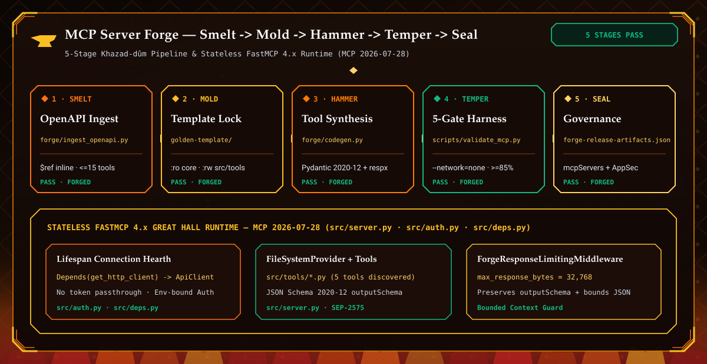
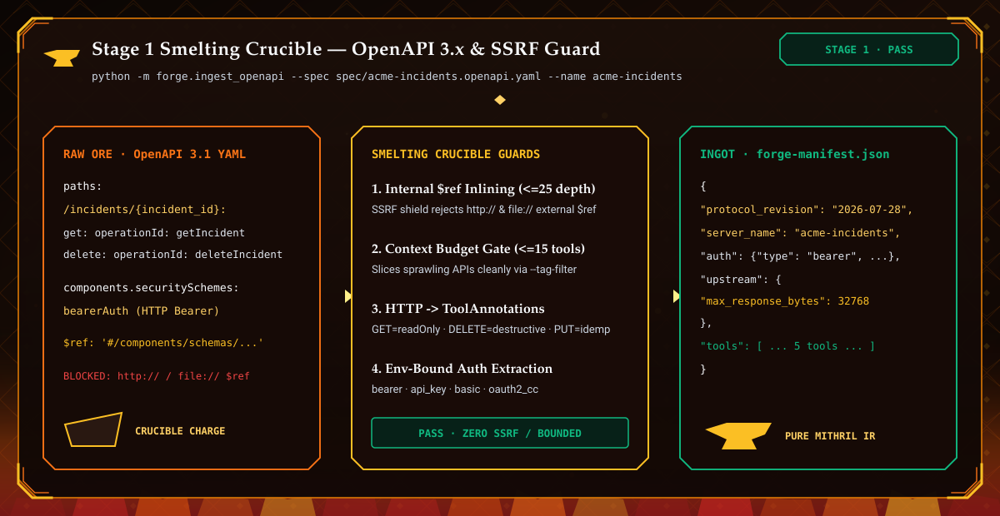
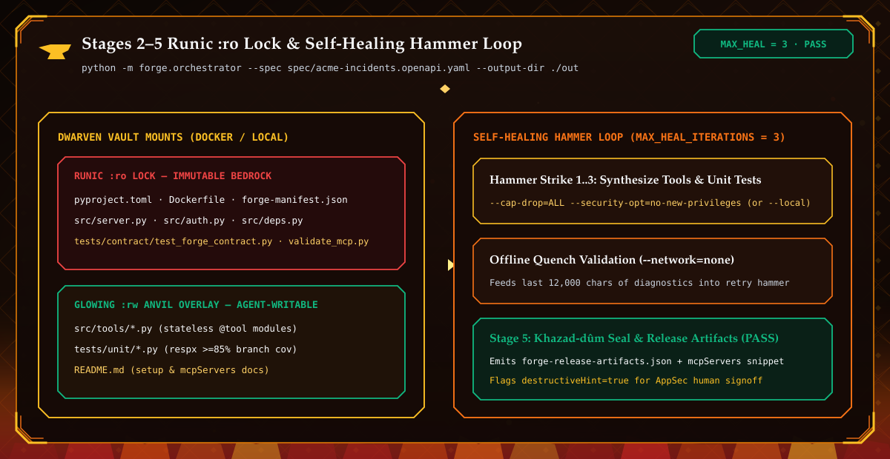
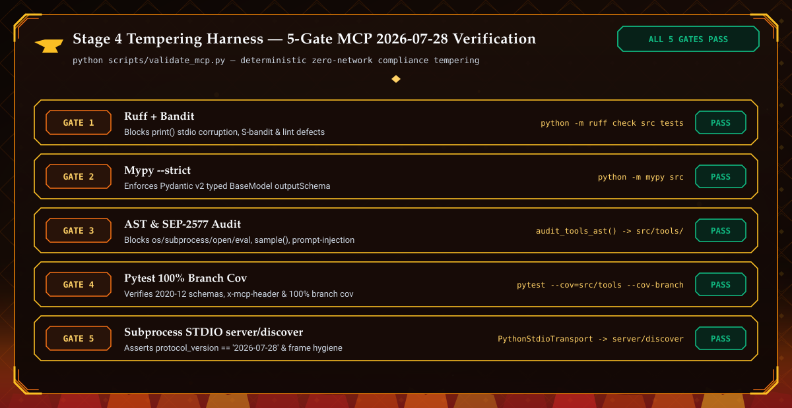
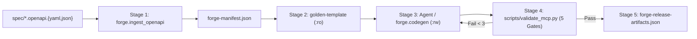

# MCP Server Forge (`2026-07-28`)

<p align="center">
  
</p>

<details>
<summary>Forge Crest (Khazad-dûm Terminal ASCII Banner)</summary>

```text
╔══════════════════════════════════════════════════════════════════════════════╗
║                        *  .  🔥  *   .   *  🔥  .  *                         ║
║                    ___====-_  _-====___                                      ║
║              _--^^^#####//      \\#####^^^--_     M C P   S E R V E R        ║
║           _-^##########// (    ) \\##########^-_      F O R G E              ║
║          -############//  |\^^/|  \\############-                            ║
║        _/############//   (@::@)   \\############\_   SPEC 2026-07-28        ║
║       /#############((     \\//     ))#############\  FASTMCP 4.x            ║
║       -###############\\    (oo)    //###############- 5 GATES TEMPERED      ║
║      _________________\\___/  \___//_________________                        ║
║     |___________________          ___________________|                       ║
║          \______________\        /______________/     SMELT · MOLD · HAMMER  ║
║               \__________\      /__________/          TEMPER · SEAL          ║
║                  |______________________|                                    ║
╚══════════════════════════════════════════════════════════════════════════════╝
```

</details>

> Compile any OpenAPI 3.x specification into a hardened, stateless Python 3.12 + **FastMCP 4.x** server compliant with **Model Context Protocol Specification `2026-07-28`**.

**MCP Server Forge** separates security-critical protocol infrastructure from AI-synthesized domain logic. Upstream authentication, connection pooling, `32 KiB` payload size bounds, and contract tests live inside an immutable **Golden Template** (`:ro`), while stateless `@tool` implementations (`src/tools/*.py`) are synthesized inside an isolated writable overlay (`:rw`) and verified offline across **five automated gates** (`ruff`, `mypy --strict`, AST `SEP-2577` security audit, `pytest >= 85%` branch coverage, and real subprocess `stdio` `server/discover`).

<p align="center">
  
</p>

---

## Quick Start

```bash
# 1. Clone & sync environment
git clone https://github.com/bsommers/forge.git && cd forge
uv sync

# 2. Run all 5 MCP 2026-07-28 verification gates
.venv/bin/python scripts/validate_mcp.py

# 3. Forge a verified server from an OpenAPI 3.1 spec (local offline mode, no Docker needed)
.venv/bin/python -m forge.orchestrator \
  --spec spec/acme-incidents.openapi.yaml \
  --name acme-incidents \
  --output-dir /tmp/forged-acme \
  --local

# 4. Run the reference Incident Management MCP server over STDIO
ACME_API_TOKEN="demo-token" .venv/bin/mcp-server
```

Browse the interactive showcase at [`docs/index.html`](docs/index.html) or open the live multi-agent build telemetry dashboard at [`dashboard/index.html`](dashboard/index.html).

---

## Visual Architecture & Workflow Showcase

| 5-Stage Forge Pipeline & Runtime | Stage 1 OpenAPI Crucible & SSRF Guard |
|---|---|
|  |  |
| **Stages 2–5 Self-Healing Sandbox** | **5-Gate Tempering Harness (`validate_mcp.py`)** |
|  |  |

---

## What It Does

- **Normalizes OpenAPI 3.x Safely (`forge/ingest_openapi.py`)**: Inlines internal `#/components/...` `$ref`s (`<= 25` depth), rejects external `$ref` URIs to prevent SSRF, enforces a `<= 15` tool budget per server (with `--tag-filter` slicing), and derives `ToolAnnotations` from HTTP methods.
- **Locks Security Infrastructure (`golden-template/` & `src/`)**: Enforces the MCP `2026-07-28` Token Passthrough Prohibition via server-bound `httpx.Auth` (`bearer`, `api_key_header`, `api_key_query`, `basic`, `oauth2_client_credentials`), injects pooled `httpx.AsyncClient` via `Depends(get_http_client)`, and bounds payloads (`32,768` bytes) with `ForgeResponseLimitingMiddleware` while preserving `outputSchema`.
- **Synthesizes & Self-Heals (`forge/orchestrator.py` & `forge/codegen.py`)**: Supports both privilege-dropped Docker containers (`--cap-drop=ALL`, `:ro` root + `:rw` `src/tools/`) and deterministic `--local` synthesis with up to `3` diagnostic self-healing retries.
- **Verifies Across 5 Offline Gates (`scripts/validate_mcp.py`)**: Runs Ruff + Bandit (`S`) + `T20` print ban, `mypy --strict`, AST `SEP-2577` & docstring prompt-injection audit, `pytest` contract + unit suite (**100.0% branch coverage** on `src/tools/`), and subprocess `PythonStdioTransport` `server/discover` (`2026-07-28`).
- **Packages Governance Metadata (`forge-release-artifacts.json`)**: Emits ready-to-use `mcpServers` JSON configs and flags mutating/destructive tools (`requires_appsec_destructive_signoff: true`) for AppSec review.

---

## Architecture Overview

```
          ┌─────────────────────────────────────────────────────────────────┐
          │                        MCP SERVER FORGE                         │
          │                                                                 │
  OpenAPI │  ┌──────────────────┐    ┌──────────────────┐    ┌───────────┐  │ Verified
  3.x ───►│  │ Stage 1: Ingest  │───►│ Stage 2: Lock    │───►│ Stage 3:  │  │ Server +
  Spec    │  │ ingest_openapi   │    │ golden-template  │    │ Codegen   │  │ Governance
          │  └──────────────────┘    └──────────────────┘    └─────┬─────┘  │──────────►
          │                                                        │        │
          │                          ┌─────────────────────────────▼─────┐  │
          │                          │ Stages 4–5: 5-Gate Validator +    │  │
          │                          │ Release Artifacts (Self-Healing)  │  │
          │                          └───────────────────────────────────┘  │
          └────────────────────────────────┬────────────────────────────────┘
                                           │ deploys
                            ╔══════════════▼══════════════╗
                            ║ Stateless FastMCP 4.x Server║
                            ║ MCP 2026-07-28 (stdio/HTTP) ║
                            ╚═════════════════════════════╝
```



---

## Project Structure

```
forge/
├── forge/                          — Stage 1–5 host pipeline (ingest_openapi, codegen, orchestrator)
├── golden-template/                — Immutable FastMCP 4.x Golden Template cloned in Stage 2
├── src/                            — Reference forged MCP 2026-07-28 server (acme-incidents)
│   ├── auth.py                     — Env-bound httpx.Auth factory (Bearer, APIKey, Basic, OAuth2)
│   ├── deps.py                     — Depends(get_http_client) DI + request_json error mapper
│   ├── server.py                   — Lifespan pool, FileSystemProvider, ForgeResponseLimitingMiddleware
│   └── tools/                      — 5 stateless Incident tools (get, list, create, update, delete)
├── respx/                          — Strictly-typed offline httpx transport mock library
├── spec/                           — OpenAPI 3.1 specs (acme-incidents.openapi.yaml, cloud-billing.openapi.json)
├── scripts/
│   ├── validate_mcp.py             — 5-gate deterministic MCP 2026-07-28 verification harness
│   └── render-graphics.py          — Khazad-dûm Dwarven Forge SVG + PNG generator
├── dashboard/                      — Zero-CORS live build telemetry HTML dashboard
├── tests/                          — Contract, Forge pipeline, Unit (100% tool branch cov) & Doc checks
├── docs/                           — Architecture, Purpose, How-To, Brochure, Pages & 5-chapter User Guide
├── forge-manifest.json             — Normalized MCP 2026-07-28 manifest for acme-incidents
├── forge-release-artifacts.json    — Stage 5 mcpServers config & AppSec governance report
└── Dockerfile                      — Multi-stage uv build -> non-root runtime (UID 65532)
```

---

## Reference Domain Tools (`acme-incidents`)

| Tool | Method & Path | Read-Only | Destructive | Idempotent | Summary |
|------|---------------|:---------:|:-----------:|:----------:|---------|
| `get_incident` | `GET /incidents/{incident_id}` | `true` | `false` | `true` | Retrieve concise summary and commander for an incident by ID |
| `list_incidents` | `GET /incidents` | `true` | `false` | `true` | List incidents filtered by `status`, `severity`, `limit`, and `cursor` |
| `create_incident` | `POST /incidents` | `false` | `false` | `false` | Create `sev1`–`sev4` incident with `x-mcp-header: Idempotency-Key` |
| `update_incident_status` | `PUT /incidents/{incident_id}/status` | `false` | `false` | `true` | Transition status (`investigating`, `identified`, `monitoring`, `resolved`) |
| `delete_incident` | `DELETE /incidents/{incident_id}` | `false` | `true` | `true` | Delete an incident record (triggers AppSec destructive signoff) |

---

## Configuration

| Variable | Required | Default | Description |
|----------|:--------:|---------|-------------|
| `ACME_API_TOKEN` | Yes | — | Server-bound Bearer token injected into upstream requests |
| `ACME_BASE_URL` | No | `https://api.acme.internal/v1` | Upstream REST API base URL |
| `MCP_TRANSPORT` | No | `stdio` | Transport mode: `stdio` or sessionless Streamable `http` |
| `PORT` | No | `8000` | Bind port when `MCP_TRANSPORT=http` |
| `LOG_LEVEL` | No | `INFO` | Structured `stderr` JSON log verbosity (`DEBUG`, `INFO`, `WARNING`, `ERROR`) |

---

## Development

```bash
# Sync dependencies
uv sync

# Run all 5 verification gates (Ruff, Mypy --strict, AST audit, Pytest >=85%, STDIO discover)
.venv/bin/python scripts/validate_mcp.py

# Run complete test suite with branch coverage across tools + forge pipeline
.venv/bin/python -m pytest --cov=src/tools --cov=forge --cov-branch

# Lint & strict typecheck across all packages
.venv/bin/python -m ruff check src forge respx scripts tests dashboard
.venv/bin/python -m mypy src forge respx

# Regenerate Khazad-dûm SVG + PNG visual assets
python3 -s scripts/render-graphics.py
```

---

## Deployment

```bash
# Build hardened non-root container (UID 65532:65532)
docker build -t ghcr.io/bsommers/forged-mcp-acme-incidents:1.0.0 .

# Run statelessly over STDIO
docker run -i --rm \
  -e ACME_BASE_URL="https://api.acme.internal/v1" \
  -e ACME_API_TOKEN="$ACME_API_TOKEN" \
  ghcr.io/bsommers/forged-mcp-acme-incidents:1.0.0
```

---

## Documentation & User Guide

| Document | Description |
|----------|-------------|
| **[User Guide (5 Chapters)](docs/user-guide/README.md)** | Getting started, forging servers, authoring MCP `2026-07-28` tools, CLI reference & FAQ |
| **[Documentation Hub](docs/README.md)** | Complete documentation map and recommended reading order |
| **[Interactive Showcase](docs/index.html)** | GitHub Pages visual gallery and interactive capability/gate explorer |
| **[System Architecture](docs/ARCHITECTURE.md)** | Component map, data flows, sequence/ER/state Mermaid diagrams & ADRs |
| **[Secure Design Patterns (`mcp-serve`)](docs/SECURE_DESIGN_PATTERNS.md)** | `MCP-001`–`MCP-008` patterns, spec authorities & link to [`bsommers/secure-design-patterns`](https://github.com/bsommers/secure-design-patterns) |
| **[Purpose & Threat Model](docs/PURPOSE.md)** | Problem statement, security boundaries, goals, non-goals & trade-offs |
| **[How-To Guide](docs/HOWTO.md)** | Copy-pasteable recipes for setup, `--tag-filter`, auth modes, custom tools & debugging |
| **[Product Brochure](docs/brochure.md)** | Executive showcase with Khazad-dûm visuals, personas & value pillars |
| **[Milestone Roadmap](docs/ROADMAP.md)** | Shipped (`M0`–`M3`) & planned (`M4`–`M5`) milestones, including [Plan 03: Wild OpenAPI, Payload Bounding & Composite Workflows](docs/plans/03-wild-openapi-resilience-composite-tools-and-hardened-bounds.md) |
| **[Agent Context (`AGENTS.md`)](AGENTS.md)** | Cold-start briefing, invariants & pitfalls for AI coding agents |
| **[Changelog](CHANGELOG.md)** | Release history and verification records |

---

## Contributing

1. Keep `src/{auth,deps,server}.py`, `tests/contract/`, and `scripts/validate_mcp.py` synchronized with `golden-template/`.
2. Run `.venv/bin/python scripts/validate_mcp.py` and `.venv/bin/python -m pytest` before every commit.
3. Re-run `python3 -s scripts/render-graphics.py` whenever counts, stages, or module names change.

---

## License

[MIT](LICENSE)
