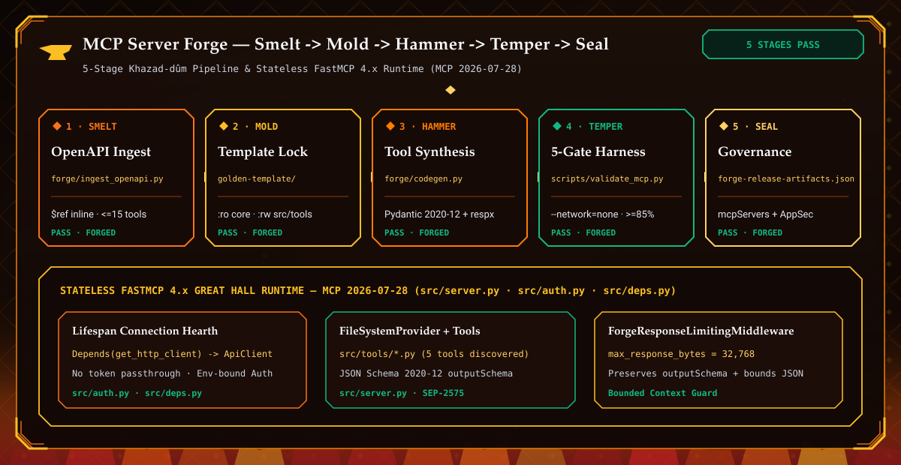
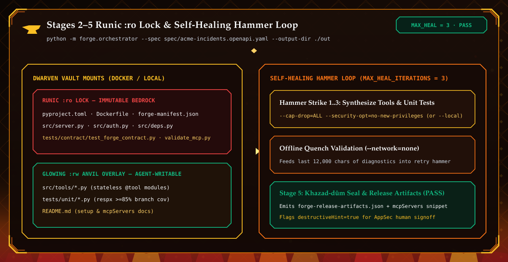
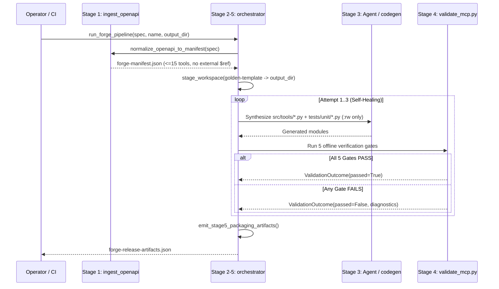
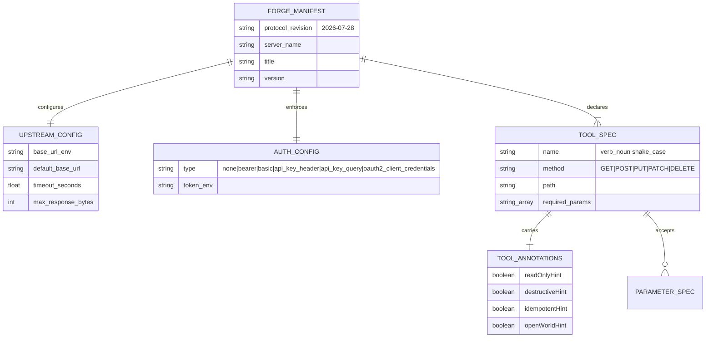
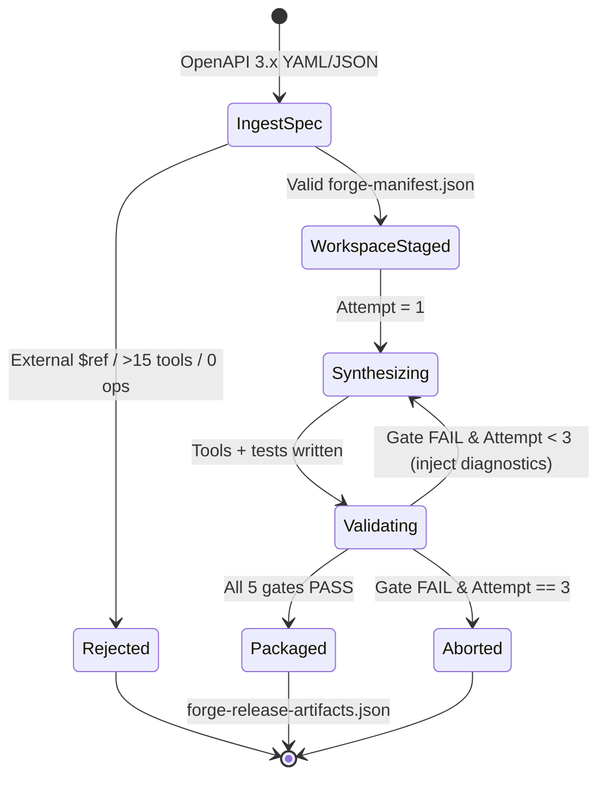
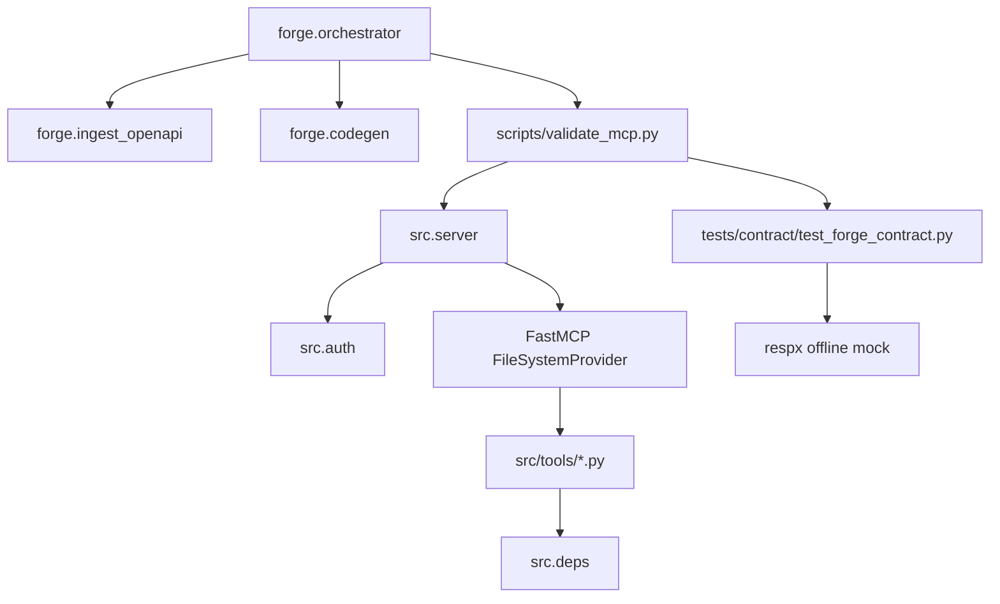
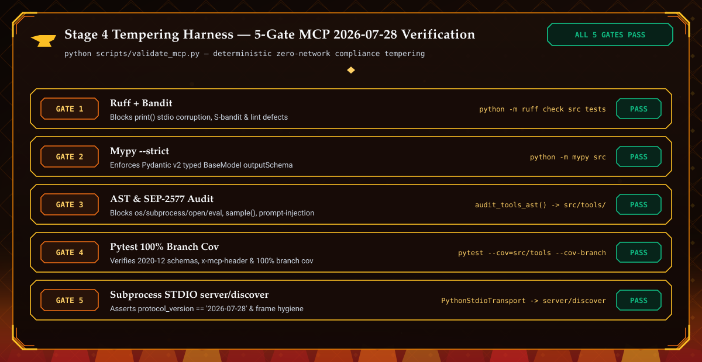

# System Architecture

<p align="center">
  
</p>

## System Overview

**MCP Server Forge** is a two-plane architecture:

1. **Build-Time Forge Pipeline (`forge/` + `golden-template/` + `scripts/validate_mcp.py`):** A deterministic 5-stage compiler and self-healing orchestrator that ingests OpenAPI 3.x specs, scaffolds a locked Golden Template workspace, synthesizes domain tools and unit tests, verifies them offline across 5 compliance gates, and emits deployment + AppSec governance artifacts.
2. **Run-Time Stateless MCP Server (`src/`):** A hardened Python 3.12+ **FastMCP 4.x** server implementing **MCP `2026-07-28`** (`SEP-2575` `server/discover`, `SEP-2567` sessionless HTTP/stdio, `SEP-2577` deprecations, and JSON Schema `2020-12` `outputSchema`/`structuredContent`).

### Top-Level Architecture

```
                     ┌───────────────────────────────────────────────────────────┐
                     │                 BUILD-TIME FORGE PIPELINE                 │
  OpenAPI 3.x Spec   │  ┌──────────────────┐    ┌─────────────────────────────┐  │
 ───────────────────►│  │ Stage 1: Ingest  │───►│ Stage 2: Golden Template    │  │
  (YAML / JSON)      │  │ ingest_openapi   │    │ (:ro core, :rw src/tools)   │  │
                     │  └──────────────────┘    └──────────────┬──────────────┘  │
                     │                                         │                 │
                     │  ┌──────────────────┐    ┌──────────────▼──────────────┐  │
  Release Artifacts  │  │ Stage 5: Package │◄───│ Stages 3–4: Synthesize &    │  │
 ◄───────────────────│  │ mcpServers + PR  │    │ 5-Gate Self-Healing Loop    │  │
                     │  └──────────────────┘    └─────────────────────────────┘  │
                     └─────────────────────────────┬─────────────────────────────┘
                                                   │ produces verified repo
                                                   ▼
                     ┌───────────────────────────────────────────────────────────┐
                     │            RUN-TIME STATELESS FASTMCP SERVER              │
  MCP Client         │  ┌──────────────────┐    ┌─────────────────────────────┐  │  Upstream API
 ═══[stdio / HTTP]══►│  │ server.py        │───►│ src/tools/*.py (@tool)      │══╪══════════════►
  server/discover    │  │ ResponseLimiter  │    │ Depends(get_http_client)    │  │  Env-Bound Auth
                     │  └──────────────────┘    └─────────────────────────────┘  │
                     └───────────────────────────────────────────────────────────┘
```

---

## Component Map

### 1. Stage 1 OpenAPI Normalizer (`forge/ingest_openapi.py`)
- **Location**: `forge/ingest_openapi.py`
- **Responsibility**: Parses OpenAPI 3.x YAML/JSON, dereferences internal `#/` pointers while blocking external URIs, enforces the `<= 15` tool cap, maps HTTP verbs to `ToolAnnotations`, extracts security schemes, and outputs `forge-manifest.json`.
- **Interfaces**: `normalize_openapi_to_manifest(spec_path, server_name, tag_filter=None) -> dict[str, Any]` and CLI `python -m forge.ingest_openapi`.
- **Dependencies**: `yaml` (`PyYAML`), Python stdlib (`json`, `re`, `copy`, `argparse`, `pathlib`).

### 2. Stages 2–5 Self-Healing Orchestrator & Synthesizer (`forge/orchestrator.py`, `forge/codegen.py`)
- **Location**: `forge/`
- **Responsibility**: Clones `golden-template/`, enforces `:ro` vs `:rw` boundaries, drives up to 3 synthesis + validation iterations (`docker` container mode or `local` deterministic Python AST/template synthesizer), and writes `forge-release-artifacts.json`.
- **Internal structure**:
  ```
  forge/
  ├── __init__.py             — Package exports
  ├── AGENT_SYSTEM_PROMPT.md  — Prompt rules injected into Stage 3 coding agents
  ├── ingest_openapi.py       — Stage 1 OpenAPI 3.x -> forge-manifest.json normalizer
  ├── codegen.py              — Deterministic FastMCP tool, respx test & README generator
  └── orchestrator.py         — Stages 2–5 runner (Docker hardened + --local modes)
  ```

### 3. Hardened FastMCP 4.x Runtime (`src/` & `golden-template/src/`)
- **Location**: `src/` (mirrored in `golden-template/src/`)
- **Responsibility**: Stateless MCP `2026-07-28` request handling, lifespan connection pooling, env-bound upstream authentication, payload size bounding, and `stderr`-only structured JSON logging.
- **Internal structure**:
  ```
  src/
  ├── auth.py                 — HeaderTokenAuth, QueryApiKeyAuth, BasicAuth, OAuth2ClientCredentialsAuth
  ├── deps.py                 — ApiClient = Annotated[httpx.AsyncClient, Depends(get_http_client)] + request_json()
  ├── server.py               — StderrJsonFormatter, server_lifespan, FileSystemProvider, ForgeResponseLimitingMiddleware
  └── tools/                  — Auto-discovered stateless domain @tool modules
      ├── get_incident.py
      ├── list_incidents.py
      ├── create_incident.py
      ├── update_incident_status.py
      └── delete_incident.py
  ```

### 4. 5-Gate Verification Harness & Offline `respx` (`scripts/validate_mcp.py`, `respx/`, `tests/contract/`)
- **Location**: `scripts/validate_mcp.py`, `respx/__init__.py`, `tests/contract/test_forge_contract.py`
- **Responsibility**: Proves protocol compliance, type safety, AST sandbox hygiene, `>= 85%` branch coverage, and clean `stdio` JSON-RPC framing without touching external networks.

### 5. Live Build Telemetry Dashboard (`dashboard/`)
- **Location**: `dashboard/`
- **Responsibility**: Tracks parallel subagent progress (`dashboard/state/*.json`), workspace file/LOC metrics, and gate status in real time via zero-CORS `<script src="status.js">` polling.

---

## Data Flow

### Flow 1 — Build-Time Self-Healing Forge Pipeline

<p align="center">
  
</p>

1. **Stage 1 (`normalize_openapi_to_manifest`)** — Reads `spec/*.yaml`, resolves internal `#/components/...` `$ref`s, validates `1 <= len(tools) <= 15`, and emits `forge-manifest.json`.
2. **Stage 2 (`stage_workspace`)** — Copies `golden-template/` into `--output-dir`, removes stub tools from `src/tools/`, initializes `tests/unit/`, and writes `forge-manifest.json`.
3. **Stage 3 (`invoke_sandboxed_agent` / `synthesize_workspace_code`)** — In `docker` mode, mounts the workspace `:ro` and overlays only `src/tools/`, `tests/unit/`, and `README.md` as `:rw` with `--cap-drop=ALL`. In `local` mode, `forge/codegen.py` deterministically emits compliant tool modules and `respx` unit tests.
4. **Stage 4 (`run_isolated_validation` / `run_local_validation`)** — Executes `scripts/validate_mcp.py`. On failure, captures the trailing 12,000 characters of `stdout`/`stderr` diagnostics and feeds them into the next self-healing retry (up to `MAX_HEAL_ITERATIONS = 3`).
5. **Stage 5 (`emit_stage5_packaging_artifacts`)** — Writes `forge-release-artifacts.json` with `mcpServers` config and AppSec review flags.



### Flow 2 — Run-Time Stateless MCP `2026-07-28` Request Lifecycle

```
  MCP Client        src/server.py            src/tools/*.py          src/deps.py + auth.py
      │                   │                        │                          │
      │── server/discover►│                        │                          │
      │◄─ 2026-07-28 ─────│                        │                          │
      │── tools/call ────►│                        │                          │
      │                   │── inject ApiClient ───►│                          │
      │                   │                        │── request_json() ───────►│
      │                   │                        │                          │── Bearer/OAuth2 ─► Upstream
      │                   │                        │◄── JSON dict ────────────│
      │                   │◄─ Pydantic BaseModel ──│                          │
      │                   │── Size Guard (<=32KB)  │                          │
      │◄─ structured + ───│                        │                          │
      │   TextContent     │                        │                          │
```

---

## Manifest & Governance Data Model



---

## Self-Healing Orchestrator State Machine



---

## Module Dependency Graph



---

## Key Design Decisions

### 1. `FileSystemProvider` Discovery Instead of `@mcp.tool` Imports
- **Context**: Importing `mcp` from `src.server` inside `src/tools/*.py` creates circular imports as soon as `src/server.py` imports `src/tools/`.
- **Decision**: `src/server.py` registers `FileSystemProvider(root=TOOLS_DIR, reload=False)` while tool modules use the standalone `@tool` decorator from `fastmcp.tools`.
- **Consequences**: Zero circular dependencies; broken tool files are caught deterministically at startup via `TOOLS_PROVIDER.failed_files`.

### 2. `ForgeResponseLimitingMiddleware` Preserving `outputSchema`
- **Context**: Upstream FastMCP `ResponseLimitingMiddleware.on_list_tools` clears `output_schema=None` because plain-text truncation would violate a declared JSON `outputSchema`. However, MCP `2026-07-28` requires typed `outputSchema` on every tool.
- **Decision**: Subclassed `ResponseLimitingMiddleware` in `src/server.py` to preserve `outputSchema` during `on_list_tools` and recursively truncate oversized string fields inside `structured_content` when serialized output exceeds `max_response_bytes`.
- **Consequences**: Clients always receive JSON Schema `2020-12` `outputSchema` AND bounded responses (`<= 32 KiB`).

### 3. First-Party Offline `respx` Transport Interceptor
- **Context**: Stage 4 verification runs with `--network=none`, and air-gapped environments may lack external mocking wheels.
- **Decision**: Shipped a strictly-typed `respx/` package hooking `httpx.AsyncHTTPTransport.handle_async_request` and `httpx.MockTransport` with LIFO route matching, regex paths, call recording, and `side_effect` exceptions.
- **Consequences**: `@respx.mock` tests run identically offline and online with zero outbound socket capability.

---

## External Dependencies

| Dependency | Type | Purpose | Version |
|------------|------|---------|---------|
| `fastmcp` | Runtime Framework | MCP `2026-07-28` server, `FileSystemProvider`, `Depends`, `Client` | `>=4.1.6,<5.0.0` |
| `httpx` | HTTP Client | Async connection-pooled upstream REST transport & custom `Auth` flows | `>=0.28.0,<1.0.0` |
| `pydantic` | Schema Validation | Typed `2020-12` `inputSchema` / `outputSchema` models | `>=2.10.0,<3.0.0` |
| `pyyaml` | Spec Parser | YAML OpenAPI 3.x ingestion in `forge/ingest_openapi.py` | `>=6.0.2` |
| `tenacity` | Resilience | Retry utilities available to Golden Template runtime | `>=9.0.0,<10.0.0` |
| `ruff` / `mypy` / `pytest` | Verification Gates | Lint, Bandit security (`S`), print ban (`T20`), `--strict` types, branch coverage | Dev group |

---

## Performance Characteristics

- **Lifespan HTTP Connection Pooling (`src/server.py`)**: A single `httpx.AsyncClient` (`max_keepalive_connections=20`, `max_connections=50`, `AsyncHTTPTransport(retries=2)`) is initialized once per server process and shared statelessly across all tool calls via `Depends(get_http_client)`.
- **OAuth2 Token Caching (`src/auth.py`)**: `OAuth2ClientCredentialsAuth` caches bearer tokens in memory until `expires_in - 60s` and automatically refreshes once on upstream HTTP `401`.
- **Bounded Context Payloads**: `max_response_bytes` (`32,768` bytes default) prevents multi-megabyte upstream responses from stalling stdio pipes or blowing out LLM prompt caches.

---

## Security Boundaries

<p align="center">
  
</p>

1. **Client <-> MCP Server Boundary**: Incoming MCP requests never supply upstream credentials (`src/auth.py` reads exclusively from `os.environ`). All `x-mcp-header` parameters are validated against RFC 9110 `tchar` syntax, primitive types (`string`/`integer`/`boolean`), and a sensitive-name blocklist (`password`, `secret`, `token`, `api_key`, `authorization`, `ssn`).
2. **Host <-> Stage 3 Coding Agent Boundary**: Docker execution drops all Linux capabilities (`--cap-drop=ALL`), blocks privilege escalation (`no-new-privileges:true`), caps PIDs (`256`) and RAM (`2g`), mounts `/workspace:ro`, and exposes only `src/tools/`, `tests/unit/`, and `README.md` as `:rw`.
3. **Tool Module AST Boundary (`scripts/validate_mcp.py`)**: Static AST inspection rejects dangerous imports (`os`, `sys`, `subprocess`, `socket`, `shutil`, `pathlib`, `ctypes`, `pickle`, `importlib`), builtins (`eval`, `exec`, `compile`, `open`, `__import__`, `print`), deprecated `SEP-2577` methods (`sample`, `list_roots`, `set_logging_level`), and docstring prompt-injection phrases.

---

## Known Limitations & Milestone Plan

Each current trade-off is tracked with measurable exit criteria in [`docs/ROADMAP.md`](ROADMAP.md):

- **Resolved in `v1.2.0` — `--local` Projection & Host-Agent Mode (`forge/projection.py`, `forge/codegen.py`, `forge/orchestrator.py`)** *(Completed in **Milestones M1 & M2** — [Plan 01](plans/01-high-signal-codegen-and-agent-refinement.md))*: `--local` mode now deterministically ranks and projects OpenAPI `2xx` response schemas (`--max-output-fields 8` + `x-mcp-fields` + collection envelopes) without raw `data: dict[str, Any]` passthrough, and `--execution-mode agent` (`--agent-cmd`) adds Docker-free semantic refinement guarded by `0444` permissions + SHA-256 lock digests.
- **Resolved in `v1.3.0` — Per-Operation Security Overrides (`src/auth.py` `RouteDispatchAuth`)** *(Completed in **Milestone M3** — [Plan 02](plans/02-per-operation-auth-and-multi-tag-sharding.md))*: Stage 1 extracts all declared `securitySchemes` plus root and operation-level `security` overrides (including `security: []` public endpoints and scoped OAuth2 profiles), routing credentials per request over the shared `httpx.AsyncClient` pool.
- **`application/json` Request Bodies**: Stage 1 extracts request body schemas from `application/json` media types; `multipart/form-data` binary uploads are intentionally out of scope for text/JSON MCP tools.
- **Resolved in `v1.3.0` — Automated 15-Tool Suite Sharding (`--auto-split-tags`)** *(Completed in **Milestone M3** — [Plan 02](plans/02-per-operation-auth-and-multi-tag-sharding.md))*: Large monolithic OpenAPI specs can be sliced manually via `--tag-filter` or partitioned automatically into `<= 15`-tool domain shards and a unified `forge-suite-artifacts.json` bundle via `--auto-split-tags`.
