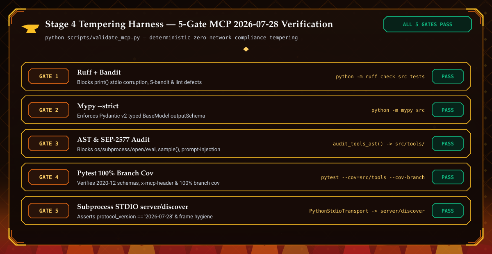
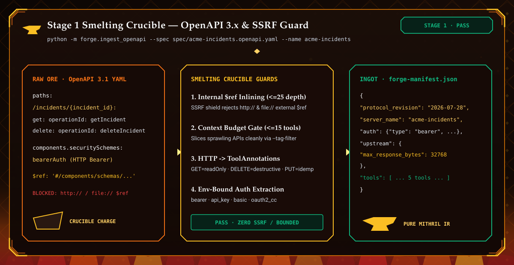

# How-To Guide & Operational Recipes

<p align="center">
  
</p>

## Contents

- [Set up development environment](#set-up-development-environment)
- [Run the MCP server](#run-the-mcp-server)
- [Run the 5-gate verification suite](#run-the-5-gate-verification-suite)
- [Forge a new MCP server from an OpenAPI 3.x spec](#forge-a-new-mcp-server-from-an-openapi-3x-spec)
- [Slice a large OpenAPI spec with `--tag-filter`](#slice-a-large-openapi-spec-with---tag-filter)
- [Add a custom MCP `2026-07-28` tool](#add-a-custom-mcp-2026-07-28-tool)
- [Configure upstream authentication modes](#configure-upstream-authentication-modes)
- [Launch the live build dashboard](#launch-the-live-build-dashboard)
- [Deploy with hardened non-root Docker](#deploy-with-hardened-non-root-docker)
- [Debug common problems](#debug-common-problems)

---

## Set up development environment

**Prerequisites**: Python `3.12+` and [`uv`](https://docs.astral.sh/uv/) (Docker optional, required only for `--execution-mode docker`).

```bash
# 1. Clone the repository
git clone https://github.com/bsommers/forge.git
cd forge

# 2. Create virtualenv and install runtime + dev dependencies
uv sync

# 3. Verify all 5 compliance gates pass out of the box
.venv/bin/python scripts/validate_mcp.py
# Expected final line:
# [PASS] All MCP Server Forge (2026-07-28) verification gates succeeded.
```

---

## Run the MCP server

```bash
# Mode A: STDIO transport (default — used by Claude Desktop, Antigravity, Cursor)
export ACME_API_TOKEN="your-upstream-bearer-token"
export ACME_BASE_URL="https://api.acme.internal/v1"
.venv/bin/mcp-server

# Mode B: Sessionless Streamable HTTP transport (SEP-2567)
export ACME_API_TOKEN="your-upstream-bearer-token"
export MCP_TRANSPORT="http"
export PORT="8000"
.venv/bin/mcp-server
```

---

## Run the 5-gate verification suite

<p align="center">
  
</p>

```bash
# Full 5-gate verification harness (Ruff + Mypy + AST Audit + Pytest >=85% + STDIO discover)
.venv/bin/python scripts/validate_mcp.py

# All tests (contract + forge pipeline + unit + doc alignment) with branch coverage
.venv/bin/python -m pytest --cov=src/tools --cov=forge --cov-branch

# Contract suite only
.venv/bin/python -m pytest tests/contract/test_forge_contract.py -v

# Regenerate Khazad-dûm SVG + PNG graphics after changing counts or modules
python3 -s scripts/render-graphics.py
```

---

## Forge a new MCP server from an OpenAPI 3.x spec

<p align="center">
  
</p>

### Option A — Local Deterministic Mode (No Docker Required)

```bash
.venv/bin/python -m forge.orchestrator \
  --spec spec/acme-incidents.openapi.yaml \
  --name acme-incidents \
  --template-dir ./golden-template \
  --prompt-file ./forge/AGENT_SYSTEM_PROMPT.md \
  --output-dir ./out/acme-incidents \
  --local
```

This runs all 5 stages locally, validates the generated workspace with `scripts/validate_mcp.py`, and writes `./out/acme-incidents/forge-release-artifacts.json`.

### Option B — Hardened Docker Container Mode

```bash
export ANTHROPIC_API_KEY="sk-ant-..."
.venv/bin/python -m forge.orchestrator \
  --spec spec/acme-incidents.openapi.yaml \
  --name acme-incidents \
  --output-dir ./out/acme-incidents \
  --execution-mode docker \
  --agent-image mcp-forge-agent:latest \
  --validator-image mcp-forge-validator:latest \
  --registry-prefix ghcr.io/bsommers
```

---

## Slice a large OpenAPI spec with `--tag-filter`

When an OpenAPI specification defines more than 15 operations, split it by OpenAPI tag into focused domain servers:

```bash
# Inspect normalized manifest for just the 'invoices' tag in cloud-billing.openapi.json
.venv/bin/python -m forge.ingest_openapi \
  --spec spec/cloud-billing.openapi.json \
  --name cloud-billing-invoices \
  --tag-filter invoices \
  --output /tmp/invoices-manifest.json

# Or automatically partition an entire multi-tag (>15-tool) OpenAPI spec into verified domain shards:
.venv/bin/python -m forge.orchestrator \
  --spec spec/cloud-billing.openapi.json \
  --name cloud-billing \
  --output-dir /tmp/forged-billing-suite \
  --auto-split-tags \
  --local
# Emits /tmp/forged-billing-suite/forge-suite-artifacts.json with merged mcpServers config
```

---

## Add a custom MCP `2026-07-28` tool

**1. Register the tool metadata in `forge-manifest.json`**

```json
{
  "name": "acknowledge_incident",
  "title": "Acknowledge Incident",
  "method": "POST",
  "path": "/incidents/{incident_id}/ack",
  "description": "Record responder acknowledgement for an active operational incident.",
  "annotations": {
    "readOnlyHint": false,
    "destructiveHint": false,
    "idempotentHint": true,
    "openWorldHint": true
  },
  "required_params": ["incident_id"]
}
```

**2. Create `src/tools/acknowledge_incident.py`** (`FileSystemProvider` discovers it automatically)

```python
from __future__ import annotations

from typing import Annotated

from fastmcp.tools import tool
from mcp.types import ToolAnnotations
from pydantic import BaseModel, Field

from src.deps import ApiClient, request_json


class AcknowledgeResult(BaseModel):
    id: str = Field(description="Incident identifier.")
    acknowledged: bool = Field(description="Whether acknowledgement succeeded.")


@tool(
    name="acknowledge_incident",
    title="Acknowledge Incident",
    annotations=ToolAnnotations(
        readOnlyHint=False,
        destructiveHint=False,
        idempotentHint=True,
        openWorldHint=True,
    ),
)
async def acknowledge_incident(
    incident_id: Annotated[
        str,
        Field(min_length=1, max_length=64, pattern=r"^[A-Za-z0-9_-]+$", description="Incident ID."),
    ],
    client: ApiClient,
) -> AcknowledgeResult:
    """Record responder acknowledgement for an active operational incident."""
    payload = await request_json(client, "POST", f"/incidents/{incident_id}/ack")
    return AcknowledgeResult(
        id=str(payload.get("id", incident_id)),
        acknowledged=bool(payload.get("acknowledged", True)),
    )
```

**3. Add `@respx.mock` unit tests in `tests/unit/test_tools.py` and verify**

```bash
.venv/bin/python scripts/validate_mcp.py
```

---

## Configure upstream authentication modes

`src/auth.py` supports 6 declarative `auth.type` configurations inside `forge-manifest.json`:

```json
// 1. Bearer Token
{"type": "bearer", "token_env": "ACME_API_TOKEN"}

// 2. Custom API Key Header
{"type": "api_key_header", "key_env": "BILLING_API_KEY", "header_name": "X-Billing-Key"}

// 3. Query Parameter API Key
{"type": "api_key_query", "key_env": "SEARCH_API_KEY", "param_name": "api_key"}

// 4. HTTP Basic Auth
{"type": "basic", "username_env": "SVC_USERNAME", "password_env": "SVC_PASSWORD"}

// 5. OAuth2 Client Credentials (auto-cached & auto-refreshed on 401)
{
  "type": "oauth2_client_credentials",
  "token_url_env": "OAUTH_TOKEN_URL",
  "client_id_env": "OAUTH_CLIENT_ID",
  "client_secret_env": "OAUTH_CLIENT_SECRET",
  "scope": "incidents:read incidents:write"
}

// 6. Unauthenticated internal upstream
{"type": "none"}
```

---

## Launch the live build dashboard

```bash
# Refresh status.js snapshot once
.venv/bin/python dashboard/telemetry.py --once

# Stream telemetry continuously every 1.5s and open in default browser
.venv/bin/python dashboard/telemetry.py --watch --duration 300 --interval 1.5 &
open dashboard/index.html
```

---

## Deploy with hardened non-root Docker

```bash
# Build multi-stage non-root image (UID 65532:65532)
docker build -t ghcr.io/bsommers/forged-mcp-acme-incidents:1.0.0 .

# Run statelessly over STDIO
docker run -i --rm \
  -e ACME_BASE_URL="https://api.acme.internal/v1" \
  -e ACME_API_TOKEN="$ACME_API_TOKEN" \
  ghcr.io/bsommers/forged-mcp-acme-incidents:1.0.0
```

---

## Debug common problems

### 1. Tool with `x-mcp-header` disappears from `client.list_tools()`
- **Cause**: In `mcp==2.3.0`, parameters carrying `json_schema_extra={"x-mcp-header": "..."}` must have a direct primitive `"type"` (`string`, `integer`, or `boolean`). Using `str | None` generates `anyOf: [{"type": "string"}, {"type": "null"}]`, causing client-side header validation to drop or reject the schema.
- **Fix**: Declare optional header-mirrored fields with a non-union default (`Annotated[str, Field(default="", json_schema_extra={"x-mcp-header": "Idempotency-Key"})] = ""`) and treat `""` as unset inside the tool body (see `src/tools/create_incident.py`).

### 2. `[FAIL] AST Security Audit` when running `scripts/validate_mcp.py`
- **Cause**: A file under `src/tools/` imported a blocked module (`os`, `sys`, `pathlib`, `subprocess`, etc.), called `print()` or `open()`, or included a prompt-injection phrase (`"system prompt"`, `"ignore previous instructions"`, `"you must always call"`) in a docstring.
- **Fix**: Keep all environment/config lookups in `src/auth.py` or `src/server.py`, route all HTTP traffic through `await request_json(client, ...)` from `src.deps`, and keep tool docstrings factual.

### 3. `ManifestConfigError: Missing required credential environment variable`
- **Cause**: `server_lifespan` validates required `*_env` secrets at startup before accepting tool calls.
- **Fix**: Export the variable named in `forge-manifest.json` (e.g., `export ACME_API_TOKEN="..."`) before starting `mcp-server`.

### 4. `SpecNormalizationError: Spec yielded N tools (max 15)`
- **Cause**: The input OpenAPI spec contains more than 15 HTTP operations.
- **Fix**: Re-run `forge.ingest_openapi` or `forge.orchestrator` with `--tag-filter <tag>` to emit domain-scoped servers of `<= 15` tools each.
