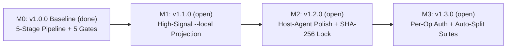

# MCP Server Forge — Milestone Roadmap

> **Status Legend:** `done` = shipped & verified · `open` = planned with acceptance criteria & verify command · `proposed` = future extension

[← Back to Project README](../README.md) · [Documentation Hub](README.md) · [M1/M2 Implementation Plan](plans/01-high-signal-codegen-and-agent-refinement.md)

---

## Overview

This roadmap tracks how **MCP Server Forge** evolves from its `v1.0.0` baseline to eliminate current synthesis and ingestion trade-offs while preserving all five locked **MCP `2026-07-28`** compliance gates.

---

## Milestone Summary

| Milestone | Target | Status | Focus | Exit Gate Command |
|-----------|--------|:------:|-------|-------------------|
| **M0** | `v1.0.0` | `done` | Core Stage 1–5 pipeline, FastMCP 4.x Golden Template, 5-gate validator, `acme-incidents` server (`100%` branch cov), Khazad-dûm docs & Pages | `.venv/bin/python scripts/validate_mcp.py` |
| **M1** | `v1.1.0` | `open` | **High-Signal Response Schema Projection in `--local` Mode** — Trim 100-field OpenAPI responses down to top-`N` typed fields (`--max-output-fields`) & list/cursor envelopes without raw `data: dict[str, Any]` dumps | `.venv/bin/python -m pytest tests/forge/test_schema_projection.py -q && .venv/bin/python scripts/validate_mcp.py` |
| **M2** | `v1.2.0` | `open` | **Docker-Free Host-Agent Semantic Refinement (`--execution-mode agent`)** — Pair deterministic `--local` scaffolding with a host CLI coding agent (`--agent-cmd`) guarded by `0444` locks + SHA-256 tamper checks | `.venv/bin/python -m pytest tests/forge/test_host_agent_mode.py -q && .venv/bin/python scripts/validate_mcp.py` |
| **M3** | `v1.3.0` | `open` | **Per-Operation Auth Overrides & Multi-Tag Suite Sharding (`--auto-split-tags`)** — Support operation-level OpenAPI `security` schemes and auto-partition `> 15`-tool specs into multi-server workspaces | `.venv/bin/python -m pytest tests/forge/test_multi_shard.py -q && .venv/bin/python scripts/validate_mcp.py` |

---

## Detailed Work Items & Gap Matrix

| ID | Gap Addressed | Milestone | Type | Effort | Depends On | Acceptance Criteria | Verify Command |
|----|---------------|:---------:|:----:|:------:|------------|---------------------|----------------|
| **W1.1** | `forge/ingest_openapi.py` drops OpenAPI `2xx` `application/json` response schemas and `x-mcp-fields` hints | **M1** | `grow` | `S` | M0 | `forge-manifest.json` tool entries include resolved `response_schema` (`200`/`201`/`202`) and optional `x_mcp_fields: list[str]` with zero external `$ref`s | `.venv/bin/python -m pytest tests/forge/test_ingest_openapi.py -k response_schema` |
| **W1.2** | `--local` `forge/codegen.py` emits a fixed `{id, title, status, severity, data: dict[str, Any]}` wrapper that leaks raw 100-field upstream payloads into LLM context | **M1** | `fix` | `M` | W1.1 | `render_tool_module()` ranks & projects `<= max_output_fields` (default `8`) high-signal scalar/nested summary fields (and `items: list[<Item>]` + `next_cursor` for list endpoints) with **zero** `dict[str, Any]` raw catch-all when `response_schema` defines properties | `.venv/bin/python -m pytest tests/forge/test_schema_projection.py` |
| **W1.3** | Contract suite allows `dict[str, Any]` passthrough blobs inside generated `--local` `outputSchema` | **M1** | `guard` | `S` | W1.2 | Add projection budget & schema-specificity assertions to `tests/forge/test_schema_projection.py` verifying a synthetic 100-field OpenAPI response compiles to `<= 8` projected fields and `< 2 KiB` serialized tool output | `.venv/bin/python -m pytest tests/forge/test_schema_projection.py -k hundred_field` |
| **W2.1** | Semantic domain curation (enum validation, nested field flattening like `commander.name -> commander`, bespoke docstrings) currently requires either Docker (`mcp-forge-agent:latest`) or manual edits | **M2** | `grow` | `M` | M1 | `forge.orchestrator` adds `--execution-mode agent` (`--agent-cmd`), seeding from M1 `codegen.py`, applying `0444` + SHA-256 digest verification on locked Golden Template files, and running up to 3 self-healing `validate_mcp.py` iterations on the host | `.venv/bin/python -m pytest tests/forge/test_host_agent_mode.py` |
| **W2.2** | Host-mode agent could attempt to `chmod +w` and weaken `tests/contract/test_forge_contract.py` or `src/auth.py` | **M2** | `guard` | `S` | W2.1 | `LockedWorkspaceDigest` snapshots SHA-256 of every locked path before Stage 3; any mismatch immediately aborts Stage 3 with `TamperDetectionError` and restores locked files before Stage 4 | `.venv/bin/python -m pytest tests/forge/test_host_agent_mode.py -k tamper` |
| **W3.1** | `_extract_auth_config` only inspects the first scheme in `components.securitySchemes` | **M3** | `grow` | `M` | M1 | Support operation-level `security` overrides mapped to named auth profiles in `src/auth.py` | `.venv/bin/python -m pytest tests/forge/test_ingest_openapi.py -k per_op_auth` |
| **W3.2** | Specs with `> 15` operations fail unless the user manually runs `--tag-filter` per tag | **M3** | `grow` | `M` | M1 | `forge.orchestrator --auto-split-tags` partitions large specs by tag (`<= 15` tools/shard) and emits a unified multi-server `mcpServers` bundle | `.venv/bin/python -m pytest tests/forge/test_multi_shard.py` |

---

## Execution Blueprints (`docs/plans/`)

- **[Plan 01 — High-Signal Schema Projection & Host-Agent Semantic Refinement (Milestones M1 & M2)](plans/01-high-signal-codegen-and-agent-refinement.md)** (`status: open`) — Complete contract-first specification, field-ranking algorithm, SHA-256 lock guard, pre-build test matrix, and dependency-ordered tasks.
