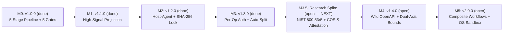

# MCP Server Forge — Milestone Roadmap

> **Status Legend:** `done` = shipped & verified · `open` = planned with acceptance criteria & verify command · `proposed` = future extension

[← Back to Project README](../README.md) · [Documentation Hub](README.md) · [Secure Design Patterns](SECURE_DESIGN_PATTERNS.md) · [Plan 03 (M4/M5)](plans/03-wild-openapi-resilience-composite-tools-and-hardened-bounds.md)

---

## Overview

This roadmap tracks how **MCP Server Forge** evolves from its `v1.0.0` baseline through `v1.3.0` (`done`) and into **Milestones M4 (`v1.4.0`) and M5 (`v2.0.0`)** to eliminate wild OpenAPI edge cases, high-cardinality payload budget bypasses, and chatty 1:1 CRUD tool proliferation while preserving all five locked **MCP `2026-07-28`** compliance gates.

---

## Milestone Summary

| Milestone | Target | Status | Focus | Exit Gate Command |
|-----------|--------|:------:|-------|-------------------|
| **M0** | `v1.0.0` | `done` | Core Stage 1–5 pipeline, FastMCP 4.x Golden Template, 5-gate validator, `acme-incidents` server (`100%` branch cov), Khazad-dûm docs & Pages | `.venv/bin/python scripts/validate_mcp.py` |
| **M1** | `v1.1.0` | `done` | **High-Signal Response Schema Projection in `--local` Mode** — Trim 100-field OpenAPI responses down to top-`N` typed fields (`--max-output-fields`) & list/cursor envelopes without raw `data: dict[str, Any]` dumps | `.venv/bin/python -m pytest tests/forge/test_schema_projection.py -q && .venv/bin/python scripts/validate_mcp.py` |
| **M2** | `v1.2.0` | `done` | **Docker-Free Host-Agent Semantic Refinement (`--execution-mode agent`)** — Pair deterministic `--local` scaffolding with a host CLI coding agent (`--agent-cmd`) guarded by `0444` locks + SHA-256 tamper checks | `.venv/bin/python -m pytest tests/forge/test_host_agent_mode.py -q && .venv/bin/python scripts/validate_mcp.py` |
| **M3** | `v1.3.0` | `done` | **Per-Operation Auth Overrides, Multi-Tag Suite Sharding (`--auto-split-tags`) & Hardened CI/Pages** — `RouteDispatchAuth` per-tool auth routing, automatic `<= 15`-tool sharding, and SHA-pinned GitHub Actions CI + Pages | `.venv/bin/python -m pytest tests/forge/test_per_op_auth.py tests/forge/test_multi_shard.py -q && .venv/bin/python scripts/validate_mcp.py` |
| **M3.5 (Next)** | `Spike` | `open` | **Research Spike: NIST SP 800-53r5 Update 1 & COSIS Use-Case Control Attestation** — Bridge [`bsommers/security-controls`](https://github.com/bsommers/security-controls) (`UC-GEN`, `UC-PRED`, `UC-AGENT-SINGLE`, `UC-AGENT-MULTI`, `UC-DEV`) with Stage 5 deterministic OSCAL `1.1.2` attestation | `.venv/bin/python scripts/validate_mcp.py` |
| **M4** | `v1.4.0` | `open` | **Wild OpenAPI Resilience & Dual-Axis Payload Bounding** — Cycle-safe/relative `$ref`s (`MCP-004`), `allOf`/`oneOf` + data-carrier projection, typed `requestBody` models, and list-cardinality + byte bounding in `ForgeResponseLimitingMiddleware` (`MCP-003`) | `.venv/bin/python -m pytest tests/forge/ tests/unit/ -q && .venv/bin/python scripts/validate_mcp.py` |
| **M5** | `v2.0.0` | `open` | **Composite Intent Workflows, Active Toolset Budgets & Kernel Sandboxing** — Multi-endpoint `x-mcp-workflows` server-side joins (`MCP-005`), `<= 15`-tool client profiles, OS `sandbox-exec`/`bwrap` host isolation (`MCP-008`), and recorded fixture replay | `.venv/bin/python -m pytest -q && .venv/bin/python scripts/validate_mcp.py` |

---

## Detailed Work Items & Gap Matrix

| ID | Gap Addressed | Milestone | Type | Effort | Depends On | Acceptance Criteria | Verify Command |
|----|---------------|:---------:|:----:|:------:|------------|---------------------|----------------|
| **W1.1** | `forge/ingest_openapi.py` drops OpenAPI `2xx` `application/json` response schemas and `x-mcp-fields` hints | **M1** | `grow` | `S` | M0 | `forge-manifest.json` tool entries include resolved `response_schema` (`200`/`201`/`202`) and optional `x_mcp_fields: list[str]` with zero external `$ref`s | `.venv/bin/python -m pytest tests/forge/test_ingest_openapi.py -k response_schema` |
| **W1.2** | `--local` `forge/codegen.py` emits a fixed `{id, title, status, severity, data: dict[str, Any]}` wrapper that leaks raw 100-field upstream payloads into LLM context | **M1** | `fix` | `M` | W1.1 | `render_tool_module()` ranks & projects `<= max_output_fields` (default `8`) high-signal scalar/nested summary fields (and `items: list[<Item>]` + `next_cursor` for list endpoints) with **zero** `dict[str, Any]` raw catch-all when `response_schema` defines properties | `.venv/bin/python -m pytest tests/forge/test_schema_projection.py` |
| **W1.3** | Contract suite allows `dict[str, Any]` passthrough blobs inside generated `--local` `outputSchema` | **M1** | `guard` | `S` | W1.2 | Add projection budget & schema-specificity assertions to `tests/forge/test_schema_projection.py` verifying a synthetic 100-field OpenAPI response compiles to `<= 8` projected fields and `< 2 KiB` serialized tool output | `.venv/bin/python -m pytest tests/forge/test_schema_projection.py -k hundred_field` |
| **W2.1** | Semantic domain curation (enum validation, nested field flattening like `commander.name -> commander`, bespoke docstrings) currently requires either Docker (`mcp-forge-agent:latest`) or manual edits | **M2** | `grow` | `M` | M1 | `forge.orchestrator` adds `--execution-mode agent` (`--agent-cmd`), seeding from M1 `codegen.py`, applying `0444` + SHA-256 digest verification on locked Golden Template files, and running up to 3 self-healing `validate_mcp.py` iterations on the host | `.venv/bin/python -m pytest tests/forge/test_host_agent_mode.py` |
| **W2.2** | Host-mode agent could attempt to `chmod +w` and weaken `tests/contract/test_forge_contract.py` or `src/auth.py` | **M2** | `guard` | `S` | W2.1 | `LockedWorkspaceDigest` snapshots SHA-256 of every locked path before Stage 3; any mismatch immediately aborts Stage 3 with `TamperDetectionError` and restores locked files before Stage 4 | `.venv/bin/python -m pytest tests/forge/test_host_agent_mode.py -k tamper` |
| **W3.1** | `_extract_auth_config` only inspects the first scheme in `components.securitySchemes` | **M3** | `grow` | `M` | M1 | Support operation-level `security` overrides mapped to named auth profiles in `src/auth.py` | `.venv/bin/python -m pytest tests/forge/test_ingest_openapi.py -k per_op_auth` |
| **W3.2** | Specs with `> 15` operations fail unless the user manually runs `--tag-filter` per tag | **M3** | `grow` | `M` | M1 | `forge.orchestrator --auto-split-tags` partitions large specs by tag (`<= 15` tools/shard) and emits a unified multi-server `mcpServers` bundle | `.venv/bin/python -m pytest tests/forge/test_multi_shard.py` |
| **W4.1** | Cyclic `$ref`s (`User.manager -> User`) crash `_resolve_local_refs` at `depth > 25`; split relative specs (`./common.yaml#/Error`) are rejected | **M4** | `fix` | `M` | M3 | `ancestor_refs` breaks `$ref` cycles into `{id: str}` stubs; relative file `$ref`s resolve strictly inside `spec_dir.resolve()` while blocking `../` & `http(s)://` | `.venv/bin/python -m pytest tests/forge/test_cyclic_and_relative_refs.py` |
| **W4.2** | `allOf`/`oneOf`/`anyOf` schemas degrade to `{id, status}` stubs and `projection.py` drops nested data arrays (`rows`, `series`, `datapoints`) | **M4** | `fix` | `M` | W4.1 | `flatten_composed_schema()` merges `allOf` + nullable `oneOf`/`anyOf`, and `score_field()` boosts data-carrier arrays (`+75`) ahead of audit timestamps | `.venv/bin/python -m pytest tests/forge/test_polymorphic_projection.py` |
| **W4.3** | `codegen.py` coerces `POST`/`PUT` `number`, `array`, and nested `object` `requestBody` fields to `str` | **M4** | `fix` | `M` | W4.1 | Generate typed `float`, `Literal[...]`, `list[T]`, and nested `<Tool><Field>Input(BaseModel)` inputs passing `mypy --strict` | `.venv/bin/python -m pytest tests/forge/test_complex_request_body.py` |
| **W4.4** | High-cardinality arrays of short strings (`3,000 x 10B = ~150 KiB`) bypass `ForgeResponseLimitingMiddleware` `32 KiB` cap | **M4** | `guard` | `M` | M3 | Two-pass bounding in `src/server.py` + `golden-template/src/server.py` slices list cardinality (`items[:k]`) before string shrinking while preserving `outputSchema` | `.venv/bin/python -m pytest tests/unit/test_response_bounding.py` |
| **W5.1** | 1:1 CRUD wrappers force 6–10 chatty LLM round-trips per triage task, and mounting N shards re-floods client context (`> 15` tools) | **M5** | `grow` | `L` | M4 | `forge/workflows.py` compiles `x-mcp-workflows` / `forge-workflows.yaml` multi-call joins into single `@tool`s, and suite output emits `<= 15`-tool `client_profiles` | `.venv/bin/python -m pytest tests/forge/test_workflows.py` |
| **W5.2** | Host `--execution-mode agent` relies on file-mode + SHA-256 post-checks rather than OS isolation, and synthetic mocks miss upstream schema drift | **M5** | `guard` | `M` | M4 | `forge/sandbox.py` wraps host agents in `sandbox-exec` (macOS) / `bwrap` (Linux), and `--fixtures-dir` replays captured API JSON payloads against `outputSchema` | `.venv/bin/python -m pytest tests/forge/test_host_sandbox.py` |

---

## Execution Blueprints (`docs/plans/`)

- **[Plan 01 — High-Signal Schema Projection & Host-Agent Semantic Refinement (Milestones M1 & M2)](plans/01-high-signal-codegen-and-agent-refinement.md)** (`status: done`) — Complete contract-first specification, field-ranking algorithm, SHA-256 lock guard, pre-build test matrix, and dependency-ordered tasks.
- **[Plan 02 — Per-Operation Auth Overrides, Multi-Tag Sharding & Hardened CI/Pages (Milestone M3)](plans/02-per-operation-auth-and-multi-tag-sharding.md)** (`status: done`) — `RouteDispatchAuth` multi-scheme router, `plan_openapi_shards` / `--auto-split-tags` suite sharding, and SHA-pinned GitHub Actions CI + GitHub Pages deployment.
- **[Plan 03 — Wild OpenAPI Resilience, Dual-Axis Payload Bounding, Composite Workflows & Kernel Sandboxing (Milestones M4 & M5)](plans/03-wild-openapi-resilience-composite-tools-and-hardened-bounds.md)** (`status: open`) — Skeptical gap remediation blueprint paired with [`SECURE_DESIGN_PATTERNS.md`](SECURE_DESIGN_PATTERNS.md) (`MCP-001`–`MCP-008`).
- **[Plan 04 — Research Spike: NIST SP 800-53r5 Update 1 & COSIS Use-Case Control Attestation (Milestone M3.5 — Next)](plans/04-research-spike-nist-800-53-cosis-attestation.md)** (`status: open`) — Time-boxed spike connecting [`bsommers/security-controls`](https://github.com/bsommers/security-controls) (`NIST SP 800-53r5 Upd1` + `COSIS` 5 use cases) to Stage 5 OSCAL `1.1.2` attestation.
