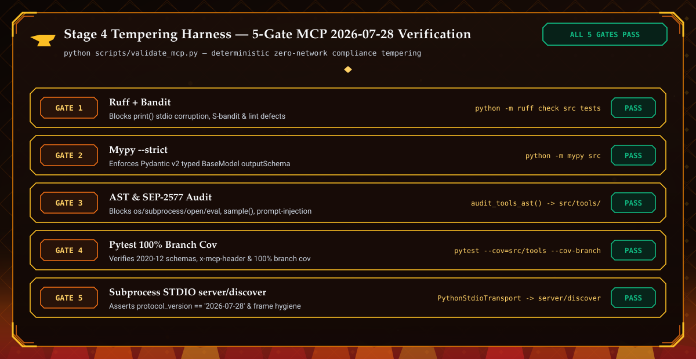
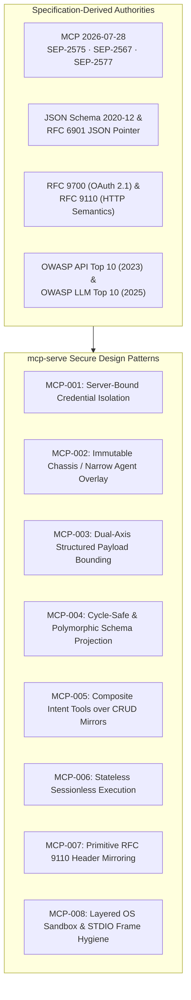

# MCP `2026-07-28` Secure Design Patterns (`mcp-serve`)

  

[← Back to Project README](../README.md) · [Documentation Hub](README.md) · [Milestone Roadmap (`M4`/`M5`)](ROADMAP.md) · [Plan 03](plans/03-wild-openapi-resilience-composite-tools-and-hardened-bounds.md)

> **Canonical Standalone Libraries:**
> - **Secure Design Patterns (`mcp-serve`):** **[`bsommers/secure-design-patterns`](https://github.com/bsommers/secure-design-patterns)** (`MCP-001`–`MCP-008` + runnable reference modules).
> - **NIST SP 800-53r5 Update 1 & COSIS Overlays:** **[`bsommers/security-controls`](https://github.com/bsommers/security-controls)** (20 control families, 5 NIST COSIS AI/SI use-case overlays, OSCAL `1.1.2` profile export, and bidirectional `MCP-001..008` crosswalk; see [Plan 04 Research Spike](plans/04-research-spike-nist-800-53-cosis-attestation.md)).

---

## 1. Why Secure Design Patterns Matter for Forged MCP Servers

Naive "OpenAPI-to-MCP" wrappers fail in production along predictable fault lines: they forward client bearer tokens to untrusted upstreams, flood the LLM context window with 80+ granular CRUD endpoints or 150 KiB JSON arrays, crash on cyclic `$ref` schemas, strip `outputSchema` inside naive truncation middleware, or mistake static AST linting for real OS containment.

To systematically overcome those failure modes, **MCP Server Forge** codifies **eight architecture and security patterns (`MCP-001` through `MCP-008`)** grounded in **normative specification authorities** and battle-tested implementation lessons.

---

## 2. Pattern Summary & Traceability Matrix

| ID | Pattern Name | Failure Mode Overcome | Primary Normative Authorities | Forge Status & Location |
|----|--------------|-----------------------|-------------------------------|-------------------------|
| **`MCP-001`** | **Server-Bound Credential Isolation** | Confused-deputy token passthrough; single-credential over-privilege on public `/health` vs. admin routes | MCP `2026-07-28` Security Best Practices (Token Passthrough Prohibition); RFC 9700 §4.14; OWASP API2:2023; CWE-287 / CWE-863 | **Shipped (`v1.0`–`v1.3`)** — `src/auth.py` (`RouteDispatchAuth`) |
| **`MCP-002`** | **Immutable Chassis / Narrow Agent Overlay** | Coding-agent reward hacking (weakening contract tests, altering auth middleware, or loosening coverage thresholds) | Saltzer & Schroeder *Complete Mediation* & *Least Privilege*; OWASP LLM06:2025 (Excessive Agency); CWE-284 | **Shipped (`v1.0`–`v1.2`)** — `golden-template/` (`:ro`) + `LockedWorkspaceDigest` (`SHA-256`) |
| **`MCP-003`** | **Dual-Axis Structured Payload Bounding** | Stock middleware stripping `outputSchema=None`; 3,000-item short-string arrays bypassing string-only `32 KiB` caps | MCP `2026-07-28` Tools `outputSchema` (`2020-12`); OWASP API4:2023; OWASP LLM10:2025 (Unbounded Consumption); CWE-770 | **String axis (`v1.0`) · Array axis (`M4 W4.4`)** — `src/server.py` (`ForgeResponseLimitingMiddleware`) |
| **`MCP-004`** | **Cycle-Safe & Polymorphic Schema Projection** | SSRF via remote `$ref`; crashes on recursive `User.manager -> User`; `{id, status}` erasure on `allOf`/`oneOf`; raw 100-field dumps | JSON Schema `2020-12` §8.2.3; RFC 6901; OpenAPI 3.1.0 §4.8.24; OWASP API4:2023; CWE-918 / CWE-674 / CWE-22 | **SSRF + Ranking (`v1.1`) · Cycles & `allOf` (`M4 W4.1–W4.3`)** — `forge/ingest_openapi.py`, `forge/projection.py` |
| **`MCP-005`** | **Composite Intent Tools over CRUD Mirrors** | 6–10 chatty LLM round-trips per triage task; mounting sharded CRUD suites that flood context past `15` tools | MCP `2026-07-28` Tool Ergonomics & Discovery (`SEP-2575`); OWASP LLM06:2025 | **15-tool cap + sharding (`v1.3`) · Workflow joins (`M5 W5.1`)** — `forge/ingest_openapi.py`, `Plan 03` |
| **`MCP-006`** | **Stateless Sessionless Execution** | Sticky `Mcp-Session-Id` horizontal-scaling failures; cross-tenant data bleed via mutable module globals; lifespan DI re-entry bugs | MCP `2026-07-28` `SEP-2575` (`server/discover`) & `SEP-2567` (Sessionless Streamable HTTP); CWE-362 / CWE-664 | **Shipped (`v1.0`)** — `src/deps.py` (`async def get_http_client`), `src/server.py` |
| **`MCP-007`** | **Primitive RFC 9110 Header Mirroring** | Header injection (`CRLF`), secret leakage in `x-mcp-header`, and `mcp==2.3.0` silently dropping tools with `str \| None` (`anyOf`) headers | MCP `2026-07-28` Header Mirroring; RFC 9110 §5.1 (`field-name = 1*tchar`); CWE-113 / CWE-200 | **Shipped (`v1.0`)** — `forge/ingest_openapi.py`, `src/tools/create_incident.py` |
| **`MCP-008`** | **Layered OS Sandbox & STDIO Frame Hygiene** | `stdout` `print()` corrupting JSON-RPC `stdio` frames; `SEP-2577` deprecated calls; mistaking AST lint for kernel containment | MCP `2026-07-28` `stdio` Transport & `SEP-2577` Deprecations; OWASP LLM05:2025; CWE-265 / CWE-116 | **Docker + AST + STDIO probe (`v1.0`) · Host OS sandbox (`M5 W5.2`)** — `scripts/validate_mcp.py`, `forge/orchestrator.py` |

---

## 3. Deep-Dive Pattern Specifications

### `MCP-001` — Server-Bound Credential Isolation (Anti-Token-Passthrough)
- **Authority:** MCP Specification `2026-07-28` Security Best Practices (*"Servers MUST NOT accept or forward client tokens not explicitly audience-scoped for the MCP server"*); OAuth 2.1 / RFC 9700 §4.14; OWASP API2:2023.
- **Problem:** Passing an MCP client's bearer token directly to an upstream REST API creates a confused-deputy vulnerability and allows malicious prompts to pivot across upstream endpoints with caller privileges. Conversely, attaching a single global server token to every route leaks credentials to unauthenticated `/health` endpoints and over-privileges read tools with admin keys.
- **Solution & Invariants:**
  1. Bind upstream credentials exclusively from server-side environment variables inside `src/auth.py` (`httpx.Auth`).
  2. Never expose `authorization`, `api_key`, `token`, or `secret` parameters in tool `inputSchema`s.
  3. Route per-operation OpenAPI `security` overrides via `RouteDispatchAuth` so `security: []` sends **zero** auth headers while admin operations use isolated scheme credentials over the same pooled `httpx.AsyncClient`.

### `MCP-002` — Immutable Chassis / Narrow Agent Overlay
- **Authority:** Saltzer & Schroeder (*Complete Mediation*, *Separation of Privilege*); OWASP LLM06:2025 (*Excessive Agency*).
- **Problem:** When an autonomous coding agent can edit `pyproject.toml`, `src/auth.py`, or `tests/contract/`, its fastest path to passing CI is weakening the test gate rather than fixing domain tool logic (reward hacking).
- **Solution & Invariants:**
  1. Partition the server into a locked **Golden Template** (`src/{auth,deps,server}.py`, `tests/contract/`, `scripts/validate_mcp.py`) and a narrow writable overlay (`src/tools/*.py`, `tests/unit/*.py`, `README.md`).
  2. In container mode, mount the workspace `:ro` and bind-mount only writable directories `:rw` with `--cap-drop=ALL`.
  3. In host mode (`--execution-mode agent`), enforce `0444` file modes **plus** `LockedWorkspaceDigest` pre/post SHA-256 verification, immediately aborting with `TamperDetectionError` and restoring bytes on any mutation.

### `MCP-003` — Dual-Axis Structured Payload Bounding
- **Authority:** MCP `2026-07-28` Tools `outputSchema` & `structuredContent` (JSON Schema `2020-12`); OWASP API4:2023 (*Unrestricted Resource Consumption*); OWASP LLM10:2025.
- **Problem:** Stock FastMCP `ResponseLimitingMiddleware` sets `output_schema=None` on `tools/list` (breaking `2026-07-28` structured tool contracts). Meanwhile, truncating only long strings (`>= 16` bytes) fails flat on high-cardinality arrays of short values (e.g., 3,000 10-byte incident IDs = `~150 KiB`).
- **Solution & Invariants:**
  1. Preserve `outputSchema` verbatim in `on_list_tools`.
  2. Bound `structuredContent` along **two axes**:
     - **Axis 1 (Collection Cardinality):** Slice oversized `list` fields (`items[:k]`, keeping `>= 1` representative item) so array schemas (`list[ItemModel]`, `list[int]`, `list[str]`) stay strictly valid against `outputSchema`.
     - **Axis 2 (String Byte Budget):** Proportionally truncate remaining long UTF-8 strings (`>= 16` bytes) with `... [truncated]`, re-serializing `TextContent` from the bounded structure.

### `MCP-004` — Cycle-Safe & Polymorphic Schema Projection
- **Authority:** JSON Schema `2020-12` §8.2.3 (`$ref`); RFC 6901 (JSON Pointer); OpenAPI 3.1.0 §4.8.24; CWE-918 (SSRF); CWE-674 (Uncontrolled Recursion).
- **Problem:** Wild OpenAPI specs use external `$ref`s (SSRF/path-traversal risk), cyclic self-references (`User.manager -> User`), and `allOf`/`oneOf` composition. Naive resolvers either crash at fixed recursion limits or collapse composed responses into `dict[str, Any]` raw dumps.
- **Solution & Invariants:**
  1. Reject any `$ref` bearing a network URI scheme (`http://`, `https://`) and confine relative file `$ref`s strictly within `spec_dir.resolve()`.
  2. Track `ancestor_refs: frozenset[str]` along the active traversal stack; when a `$ref` re-enters `ancestor_refs`, break the cycle deterministically with a shallow `{id: str}` summary stub.
  3. Flatten `allOf` property sets and `oneOf`/`anyOf` nullable unions prior to ranking, and boost structural data-carrier arrays (`rows`, `series`, `datapoints`) alongside explicit `x-mcp-fields` allowlists so domain payloads are never discarded behind metadata timestamps.

### `MCP-005` — Composite Intent Tools over 1:1 CRUD Mirrors
- **Authority:** MCP `2026-07-28` Tool Discovery (`SEP-2575`) & Context Budget Ergonomics.
- **Problem:** Exposing 1:1 REST CRUD wrappers forces an LLM to burn 6–10 sequential tool turns joining foreign keys (`get_incident` -> `list_timeline` -> `get_user`), multiplying latency and hallucination rates. Splitting a 75-endpoint spec into 5 shards still crowds tool selection if all 5 shards are mounted into one agent session.
- **Solution & Invariants:**
  1. Enforce `<= 15` tools per active client profile (not merely per server binary).
  2. Aggregate multi-endpoint read/triage joins server-side (`x-mcp-workflows` / composite `@tool` functions using `asyncio.gather` over the pooled `ApiClient`) so one MCP tool call answers one complete user intent.

### `MCP-006` — Stateless Sessionless Execution & Async DI Safety
- **Authority:** MCP `2026-07-28` `SEP-2575` (`server/discover`) & `SEP-2567` (Sessionless Streamable HTTP).
- **Problem:** Storing pagination cursors or user context in module globals causes cross-tenant state bleed and breaks horizontal load balancing under sessionless Streamable HTTP. Additionally, synchronous DI getters returning an active `httpx.AsyncClient` cause FastMCP's dependency injector to re-enter its `__aenter__` context manager and crash at runtime.
- **Solution & Invariants:**
  1. Keep `src/tools/*.py` 100% free of mutable module-level state; pass `cursor` and workflow identifiers explicitly through typed tool inputs and outputs.
  2. Declare `async def get_http_client() -> httpx.AsyncClient` (`ApiClient = Annotated[httpx.AsyncClient, Depends(get_http_client)]`) backed by a single server-lifespan connection pool.

### `MCP-007` — Primitive RFC 9110 `x-mcp-header` Mirroring
- **Authority:** MCP `2026-07-28` Streamable HTTP Header Mirroring; RFC 9110 §5.1 (`tchar`).
- **Problem:** Attaching `x-mcp-header` to untrusted header names risks HTTP header abuse, attaching it to secrets leaks credentials in transport metadata, and typing optional header-mirrored fields as `str | None` emits JSON Schema `anyOf`, causing `mcp==2.3.0` to silently drop the entire tool from `tools/list`.
- **Solution & Invariants:**
  1. Validate header names against `^[!#$%&'*+\-.^_`|~0-9A-Za-z]+$` (RFC 9110 `1*tchar`).
  2. Block sensitive parameter names (`token`, `key`, `secret`, `password`, `authorization`, `cookie`, `ssn`) and complex types (`object`, `array`, `number`).
  3. Declare optional `x-mcp-header` parameters as non-union primitives (`Annotated[str, Field(default="", ...)] = ""`) and treat `""` as omitted at call time.

### `MCP-008` — Layered OS Sandboxing & `stdio` Frame Hygiene
- **Authority:** MCP `2026-07-28` `stdio` Transport Specification & `SEP-2577` Deprecations.
- **Problem:** A single stray `print()` or third-party banner on `stdout` corrupts JSON-RPC framing over `stdio`. Meanwhile, AST bans on `import os` or `subprocess` catch accidental mistakes in `src/tools/*.py` but are **not** a security boundary against an untrusted process during host code generation.
- **Solution & Invariants:**
  1. Route all operational logging to `stderr` in structured JSON (`T20` Ruff print ban + live subprocess `PythonStdioTransport` `server/discover` verification gate).
  2. Enforce `SEP-2577` AST bans (`.sample()`, `.list_roots()`, `.set_logging_level()`) and imperative prompt-injection docstring checks.
  3. Pair static AST verification with kernel-level process isolation (`docker run --network=none --cap-drop=ALL`, macOS `sandbox-exec`, or Linux `bwrap --unshare-net`) whenever executing untrusted or third-party synthesis agents.
