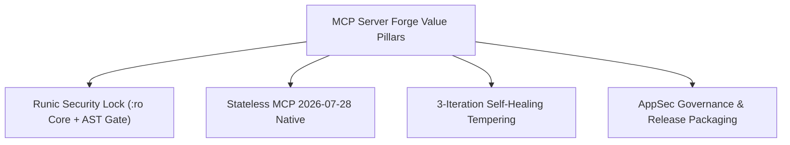
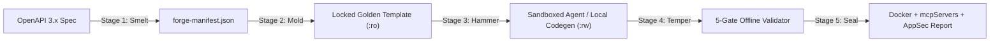

# MCP Server Forge — Executive Product Brochure

<p align="center">
  
</p>

<div align="center">

**Forged in the Deep Halls: Turn Any OpenAPI 3.x Spec into a Hardened, Stateless MCP `2026-07-28` Server**


</div>

<p align="center">
  
</p>

---

## 1. Product & Marketing Hook

> **"Stop shipping fragile, hand-rolled MCP wrappers that leak tokens and overflow context windows — forge audited, stateless MCP `2026-07-28` servers straight from OpenAPI."**

Every engineering organization wants AI agents connected to internal incident, billing, and deployment APIs. Yet hand-writing MCP wrappers takes days per service, while raw AI-generated servers routinely forward client tokens upstream, call deprecated session APIs, or dump multi-megabyte JSON blobs into agent context.

**MCP Server Forge** brings industrial-grade discipline to agent tool generation. Like a master smithy in Khazad-dûm, it locks authentication, connection pooling, payload bounds, and protocol contracts inside an immutable **Golden Template**, then hammers and tempers stateless domain tools through **five automated offline verification gates** before emitting deployment and AppSec signoff artifacts.

---

## 2. Target Audience

- **Platform & AI Infrastructure Teams**: Convert dozens of internal OpenAPI 3.x services into uniform, observable FastMCP 4.x containers in minutes instead of weeks.
- **Application Security (AppSec) Officers**: Enforce zero token passthrough, SSRF-proof `$ref` resolution, AST bans on shell/filesystem imports, and automatic PR gating on `DELETE` / mutating tools.
- **Autonomous Agent Architects**: Give Claude, Antigravity, and IDE agents crisp `<= 15`-tool surfaces with typed JSON Schema `2020-12` `outputSchema`, deterministic `tools/list` caching, and `<= 32 KiB` bounded payloads.
- **SRE & Operations Teams**: Deploy the included `acme-incidents` server immediately for incident triage, status updates, and responder workflows.

---

## 3. Purpose & Mission: Before vs. After Forge

| Dimension | Hand-Rolled / Naive AI Wrapper | MCP Server Forge (`2026-07-28`) |
|---|---|---|
| **Protocol Era** | Legacy stateful `initialize` / `ping` sessions | Modern stateless `server/discover` (`SEP-2575` / `SEP-2567`) |
| **Upstream Credentials** | Risk of forwarding client headers | Strictly env-bound `httpx.Auth` (`Bearer`, `APIKey`, `Basic`, `OAuth2`) |
| **Schema Safety** | External `$ref` SSRF & missing `outputSchema` | Inlined local `$ref`s (`<= 25` depth), typed `2020-12` `outputSchema` |
| **Context Protection** | Unbounded multi-MB API dumps | `<= 15` tools/server + `32 KiB` `ForgeResponseLimitingMiddleware` |
| **Agent Tamper Resistance** | Agent can weaken tests or edit auth | `:ro` locked runtime & contract tests; `:rw` limited to `src/tools/` |
| **Verification** | Manual spot-checking | 5 offline gates + `100%` tool branch coverage + `stdio` subprocess probe |

---

## 4. Core Value Propositions & Key Capabilities



1. **Runic Security Lock**: Core files (`src/auth.py`, `src/deps.py`, `src/server.py`, `tests/contract/`, `scripts/validate_mcp.py`) are mounted read-only; static AST checks block `os`, `subprocess`, `open`, `eval`, `print`, and prompt-injection docstrings.
2. **Stateless `2026-07-28` Native**: Built from the ground up for sessionless `server/discover`, `structuredContent`, RFC 9110 `x-mcp-header` mirroring, and zero `SEP-2577` deprecated calls.
3. **Self-Healing Tempering Loop**: Failed lint, strict-mypy, coverage, or `stdio` checks feed exact compiler/test diagnostics back into up to 3 automated repair cycles.
4. **AppSec Governance Built In**: Stage 5 emits ready-to-paste `mcpServers` configs alongside machine-readable PR labels (`needs-security-review`, `requires_appsec_destructive_signoff`).

---

## 5. Visual System Architecture

<p align="center">
  
</p>



---

## 6. Instant Onboarding & Quick Start

```bash
# 1. Clone & install
git clone https://github.com/bsommers/forge.git && cd forge
uv sync

# 2. Run all 5 verification gates on the reference Incident MCP server
.venv/bin/python scripts/validate_mcp.py

# 3. Forge a brand-new verified MCP server from OpenAPI in seconds (offline --local mode)
.venv/bin/python -m forge.orchestrator \
  --spec spec/acme-incidents.openapi.yaml \
  --name acme-incidents \
  --output-dir /tmp/forged-acme \
  --local
```

---

## 7. Where to Go for More Information

| Resource | Purpose | Direct Link |
|----------|---------|-------------|
| **Project Front Door** | Quick start, tool catalog & architecture summary | [../README.md](../README.md) |
| **Interactive Web Showcase** | GitHub Pages visual explorer & capability search | [index.html](index.html) |
| **User Guide (5 Chapters)** | Step-by-step onboarding, authoring & CLI reference | [user-guide/README.md](user-guide/README.md) |
| **System Architecture** | Subsystems, sequence/ER/state diagrams & ADRs | [ARCHITECTURE.md](ARCHITECTURE.md) |
| **Purpose & Threat Model** | Security boundaries, goals, non-goals & trade-offs | [PURPOSE.md](PURPOSE.md) |
| **Operational How-To** | Copy-pasteable recipes & troubleshooting playbook | [HOWTO.md](HOWTO.md) |
