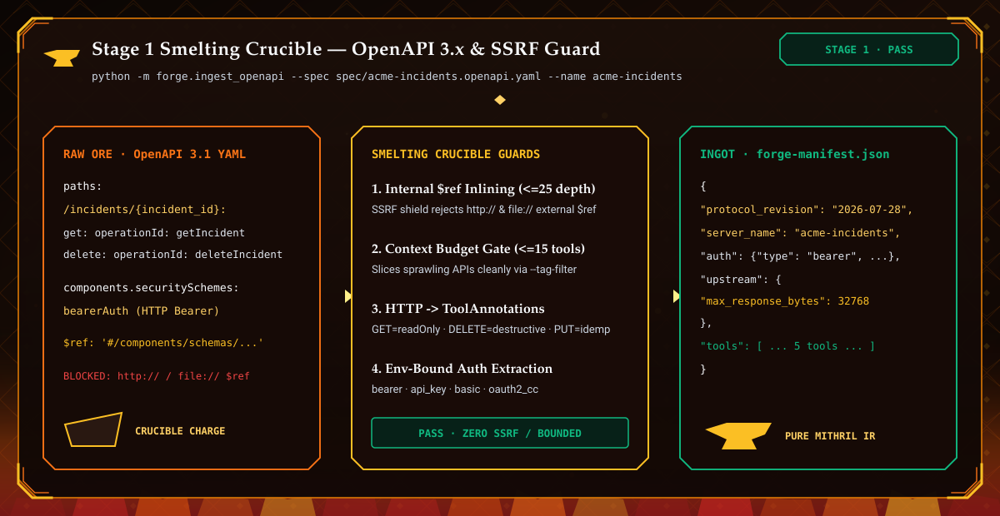
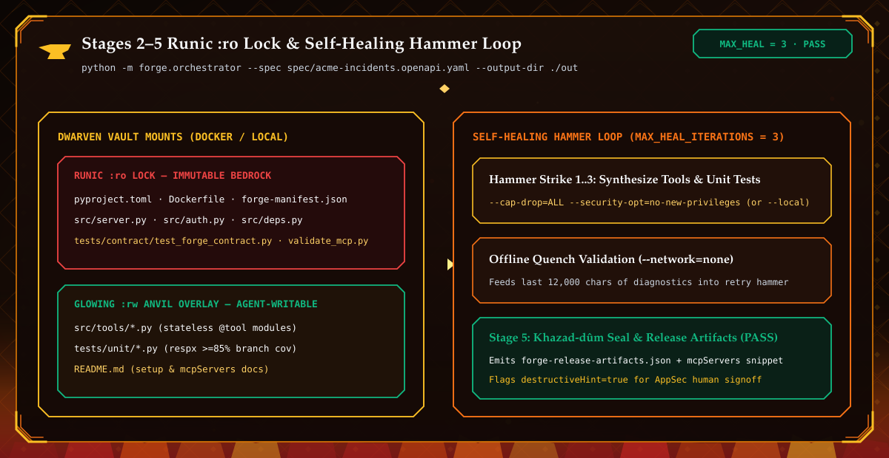

# Chapter 2 — Forging Servers from OpenAPI 3.x

[← Chapter 1: Getting Started](01-getting-started.md) · [User Guide Index](README.md) · [← Back to Project README](../../README.md)

<p align="center">
  
</p>

## Table of Contents

- [Inspecting Sample OpenAPI Specs (`spec/`)](#inspecting-sample-openapi-specs-spec)
- [Running Stage 1 Standalone (`forge.ingest_openapi`)](#running-stage-1-standalone-forgeingest_openapi)
- [Domain Slicing with `--tag-filter`](#domain-slicing-with---tag-filter)
- [Running the Full 5-Stage Pipeline (`--local` Mode)](#running-the-full-5-stage-pipeline---local-mode)
- [Running Hardened Container Mode (`--execution-mode docker`)](#running-hardened-container-mode---execution-mode-docker)
- [Understanding Stage 5 Governance Artifacts](#understanding-stage-5-governance-artifacts)

---

## Inspecting Sample OpenAPI Specs (`spec/`)

The [`spec/`](../../spec/README.md) directory ships with two complete OpenAPI 3.1 specifications:

- [`spec/acme-incidents.openapi.yaml`](../../spec/acme-incidents.openapi.yaml) — YAML specification with HTTP Bearer auth, internal `#/components/schemas/...` and `#/components/parameters/...` `$ref`s, `x-mcp-header` metadata, and 5 incident operations (`GET`, `POST`, `PUT`, `DELETE`).
- [`spec/cloud-billing.openapi.json`](../../spec/cloud-billing.openapi.json) — JSON specification with `X-Billing-Key` header auth and multiple tags (`invoices`, `budgets`, `alerts`) for testing domain slicing.

---

## Running Stage 1 Standalone (`forge.ingest_openapi`)

Convert an OpenAPI 3.x specification into a normalized `forge-manifest.json` file:

```bash
.venv/bin/python -m forge.ingest_openapi \
  --spec spec/acme-incidents.openapi.yaml \
  --name acme-incidents \
  --output /tmp/acme-manifest.json
```

Stage 1 automatically enforces four safety invariants:
1. **Internal `$ref` Inlining**: Resolves `#/...` JSON Pointers (including RFC 6901 `~0` and `~1` escapes) up to depth `25`.
2. **External `$ref` SSRF Rejection**: Raises `SpecNormalizationError` on any `http://`, `https://`, or relative file `$ref`.
3. **15-Tool Context Ceiling**: Raises `SpecNormalizationError` if `len(tools) > 15`.
4. **Semantic `ToolAnnotations`**: Maps `GET -> readOnlyHint=True`, `DELETE -> destructiveHint=True`, and `GET/PUT/DELETE -> idempotentHint=True`.

---

## Domain Slicing with `--tag-filter`

When an upstream API exposes dozens of endpoints, slice it into domain-scoped MCP servers by OpenAPI tag:

```bash
.venv/bin/python -m forge.ingest_openapi \
  --spec spec/cloud-billing.openapi.json \
  --name cloud-billing-invoices \
  --tag-filter invoices
```

---

## Running the Full 5-Stage Pipeline (`--local` Mode)

<p align="center">
  
</p>

Use `--local` (shorthand for `--execution-mode local`) to forge, synthesize, and validate a complete standalone MCP server repository without Docker:

```bash
.venv/bin/python -m forge.orchestrator \
  --spec spec/cloud-billing.openapi.json \
  --name cloud-billing-invoices \
  --tag-filter invoices \
  --template-dir ./golden-template \
  --prompt-file ./forge/AGENT_SYSTEM_PROMPT.md \
  --output-dir /tmp/forged-billing-invoices \
  --registry-prefix ghcr.io/bsommers \
  --local
```

Inside `/tmp/forged-billing-invoices`, you receive a complete, verified FastMCP 4.x repository containing:
- Locked runtime (`src/auth.py`, `src/deps.py`, `src/server.py`, `respx/`, `Dockerfile`, `pyproject.toml`)
- Generated tools (`src/tools/*.py`) and `respx` unit tests (`tests/unit/test_tools.py`)
- Contract suite (`tests/contract/test_forge_contract.py`) and validator (`scripts/validate_mcp.py`)
- Release & AppSec governance manifest (`forge-release-artifacts.json`)

---

## Running Hardened Container Mode (`--execution-mode docker`)

In CI/CD pipelines where an external LLM coding agent synthesizes richer domain projections inside a locked container:

```bash
export ANTHROPIC_API_KEY="sk-ant-..."
.venv/bin/python -m forge.orchestrator \
  --spec spec/acme-incidents.openapi.yaml \
  --name acme-incidents \
  --output-dir ./out/acme-incidents \
  --execution-mode docker \
  --agent-image mcp-forge-agent:latest \
  --validator-image mcp-forge-validator:latest
```

Stage 3 mounts `/workspace:ro` and overlays **only** `src/tools/`, `tests/unit/`, and `README.md` as `:rw`, while Stage 4 runs `scripts/validate_mcp.py` with `--network=none`.

---

## Understanding Stage 5 Governance Artifacts

Every successful pipeline run emits `forge-release-artifacts.json`:

```json
{
  "protocol_revision": "2026-07-28",
  "container_image": "ghcr.io/acme/forged-mcp-acme-incidents:1.0.0",
  "client_config": {
    "mcpServers": {
      "acme-incidents": {
        "command": "docker",
        "args": ["run", "-i", "--rm", "-e", "ACME_BASE_URL", "-e", "ACME_API_TOKEN", "ghcr.io/acme/forged-mcp-acme-incidents:1.0.0"],
        "env": {
          "ACME_BASE_URL": "${ACME_BASE_URL}",
          "ACME_API_TOKEN": "${ACME_API_TOKEN}"
        }
      }
    }
  },
  "governance": {
    "required_labels": ["needs-security-review", "mcp-2026-07-28"],
    "requires_appsec_destructive_signoff": true,
    "mutating_tools": [
      {"name": "create_incident", "method": "POST", "path": "/incidents", "destructiveHint": false},
      {"name": "update_incident_status", "method": "PUT", "path": "/incidents/{incident_id}/status", "destructiveHint": false},
      {"name": "delete_incident", "method": "DELETE", "path": "/incidents/{incident_id}", "destructiveHint": true}
    ],
    "total_tools": 5
  }
}
```

Next: **[Chapter 3 — Authoring MCP `2026-07-28` Tools & Tests](03-mcp-2026-07-28-authoring.md)**.
