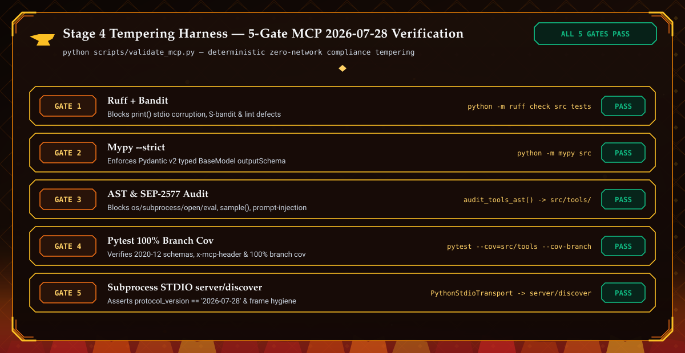

# Chapter 3 — Authoring MCP `2026-07-28` Tools & Tests

[← Chapter 2: Forging Servers](02-forging-servers.md) · [User Guide Index](README.md) · [← Back to Project README](../../README.md)

<p align="center">
  
</p>

## Table of Contents

- [MCP `2026-07-28` Authoring Rules](#mcp-2026-07-28-authoring-rules)
- [Canonical Tool Anatomy (`src/tools/<name>.py`)](#canonical-tool-anatomy-srctoolsnamepy)
- [Header Mirroring with `x-mcp-header`](#header-mirroring-with-x-mcp-header)
- [AST Security & Docstring Hygiene Gate](#ast-security--docstring-hygiene-gate)
- [Writing Offline `@respx.mock` Unit Tests](#writing-offline-respxmock-unit-tests)

---

## MCP `2026-07-28` Authoring Rules

1. **Stateless Execution (`SEP-2575` & `SEP-2567`)**: Never store mutable per-client state in module globals. Pass cursors (`cursor`, `next_cursor`) and correlation tokens explicitly via arguments and return models.
2. **Forbidden `SEP-2577` Calls**: Never invoke `ctx.sample()`, `ctx.list_roots()`, or `set_logging_level()`.
3. **Explicit Pydantic Return Model (`outputSchema`)**: Every `@tool` function MUST annotate a Pydantic `BaseModel` return type so FastMCP emits a JSON Schema `2020-12` `outputSchema` and populates `structuredContent` alongside `TextContent`.
4. **Dependency-Injected `ApiClient`**: Declare `client: ApiClient` (from `src.deps`). FastMCP injects the lifespan `httpx.AsyncClient` at call time while hiding `client` from the public `inputSchema`.
5. **Exact Manifest Parity**: `@tool(name=..., title=..., annotations=ToolAnnotations(...))` must match `forge-manifest.json` verbatim.

---

## Canonical Tool Anatomy (`src/tools/<name>.py`)

```python
from __future__ import annotations

from typing import Annotated

from fastmcp.exceptions import ToolError
from fastmcp.tools import tool
from mcp.types import ToolAnnotations
from pydantic import BaseModel, Field

from src.deps import ApiClient, request_json

ALLOWED_STATUSES = {"investigating", "identified", "monitoring", "resolved"}


class IncidentStatusUpdateResult(BaseModel):
    """Structured result returned after updating an incident's lifecycle status."""

    id: str = Field(description="Unique incident identifier.")
    status: str = Field(description="Updated lifecycle status.")
    note: str | None = Field(default=None, description="Optional responder status note.")
    updated_at: str | None = Field(default=None, description="ISO-8601 update timestamp.")


@tool(
    name="update_incident_status",
    title="Update Incident Status",
    annotations=ToolAnnotations(
        readOnlyHint=False,
        destructiveHint=False,
        idempotentHint=True,
        openWorldHint=True,
    ),
)
async def update_incident_status(
    incident_id: Annotated[
        str,
        Field(min_length=1, max_length=64, pattern=r"^[A-Za-z0-9_-]+$", description="Incident ID."),
    ],
    status: Annotated[
        str,
        Field(description="Target lifecycle status (investigating, identified, monitoring, resolved)."),
    ],
    client: ApiClient,
    note: Annotated[
        str | None,
        Field(default=None, max_length=500, description="Optional triage note."),
    ] = None,
) -> IncidentStatusUpdateResult:
    """Transition an operational incident to a new lifecycle status."""
    normalized = status.strip().lower()
    if normalized not in ALLOWED_STATUSES:
        raise ToolError(f"Invalid status '{status}'. Expected one of: {sorted(ALLOWED_STATUSES)}.")

    body: dict[str, str] = {"status": normalized}
    if note is not None:
        body["note"] = note

    data = await request_json(client, "PUT", f"/incidents/{incident_id}/status", json_body=body)
    return IncidentStatusUpdateResult(
        id=str(data.get("id", incident_id)),
        status=str(data.get("status", normalized)),
        note=data.get("note", note),
        updated_at=data.get("updated_at"),
    )
```

---

## Header Mirroring with `x-mcp-header`

MCP `2026-07-28` allows non-sensitive primitive parameters (`string`, `integer`, `boolean`) to declare `json_schema_extra={"x-mcp-header": "<Header-Name>"}` for Streamable HTTP header mirroring.

> **Important (`mcp==2.3.0` Schema Rule):** Do not type an `x-mcp-header` parameter as `str | None` (which emits `anyOf` rather than `"type": "string"`). Use `str` with `default=""` and treat `""` as omitted:

```python
idempotency_key: Annotated[
    str,
    Field(
        default="",
        max_length=128,
        description="Optional client idempotency key.",
        json_schema_extra={"x-mcp-header": "Idempotency-Key"},
    ),
] = ""
```

`tests/contract/test_forge_contract.py` enforces RFC 9110 `tchar` syntax, case-insensitive uniqueness, primitive types, and blocks sensitive parameter names (`token`, `secret`, `password`, `api_key`, `authorization`, `ssn`).

---

## AST Security & Docstring Hygiene Gate

`scripts/validate_mcp.py` parses every `.py` file under `src/tools/` with Python's `ast` module and fails the build if it detects:

- **Forbidden imports**: `os`, `sys`, `subprocess`, `socket`, `shutil`, `pathlib`, `ctypes`, `pickle`, `importlib`
- **Forbidden builtins**: `eval()`, `exec()`, `compile()`, `open()`, `__import__()`, `print()`
- **Deprecated `SEP-2577` attributes**: `.sample()`, `.list_roots()`, `.set_logging_level()`
- **Prompt-injection docstrings**: `"ignore previous instructions"`, `"system prompt"`, `"<|im_start|>"`, `"you must always call"`

---

## Writing Offline `@respx.mock` Unit Tests

Test every tool through FastMCP's in-memory `Client(mcp)` and cover both happy paths and upstream error mappings (`401`, `403`, `404`, `429`, `500`, `TimeoutException`) to maintain `>= 85%` branch coverage (`src/tools/` currently achieves **100.0%**):

```python
import httpx
import pytest
import respx
from fastmcp import Client
from fastmcp.exceptions import ToolError

from src.server import mcp


@respx.mock
async def test_get_incident_happy_and_404(monkeypatch: pytest.MonkeyPatch) -> None:
    monkeypatch.setenv("ACME_API_TOKEN", "unit-test-token")
    respx.get("https://api.acme.internal/v1/incidents/INC-42").mock(
        return_value=httpx.Response(
            200,
            json={"id": "INC-42", "title": "API latency", "severity": "sev1", "status": "open"},
        )
    )

    async with Client(mcp) as client:
        res = await client.call_tool("get_incident", {"incident_id": "INC-42"})
        assert res.structured_content is not None
        assert res.structured_content["id"] == "INC-42"

        respx.get("https://api.acme.internal/v1/incidents/INC-404").mock(
            return_value=httpx.Response(404, json={"detail": "Not found"})
        )
        with pytest.raises(ToolError, match="HTTP 404"):
            await client.call_tool("get_incident", {"incident_id": "INC-404"})
```

Next: **[Chapter 4 — CLI, Manifest & Environment Reference](04-cli-and-config-reference.md)**.
